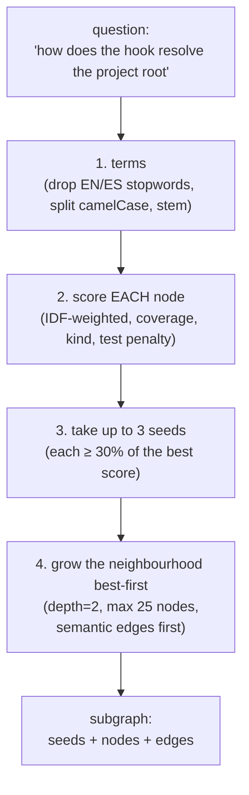
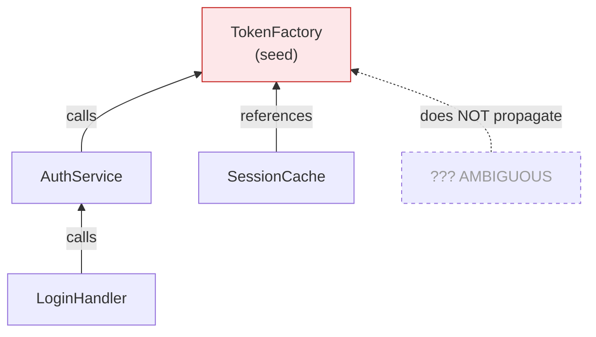
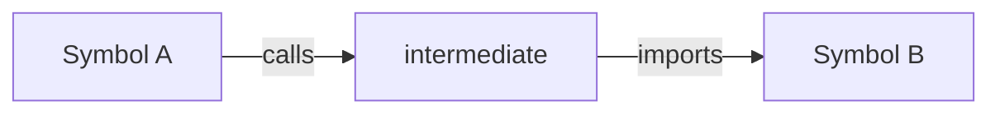
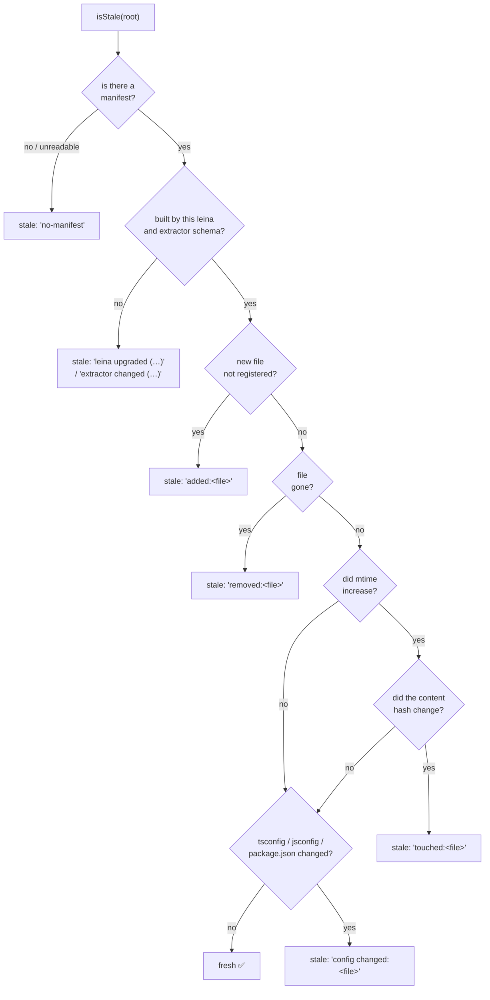
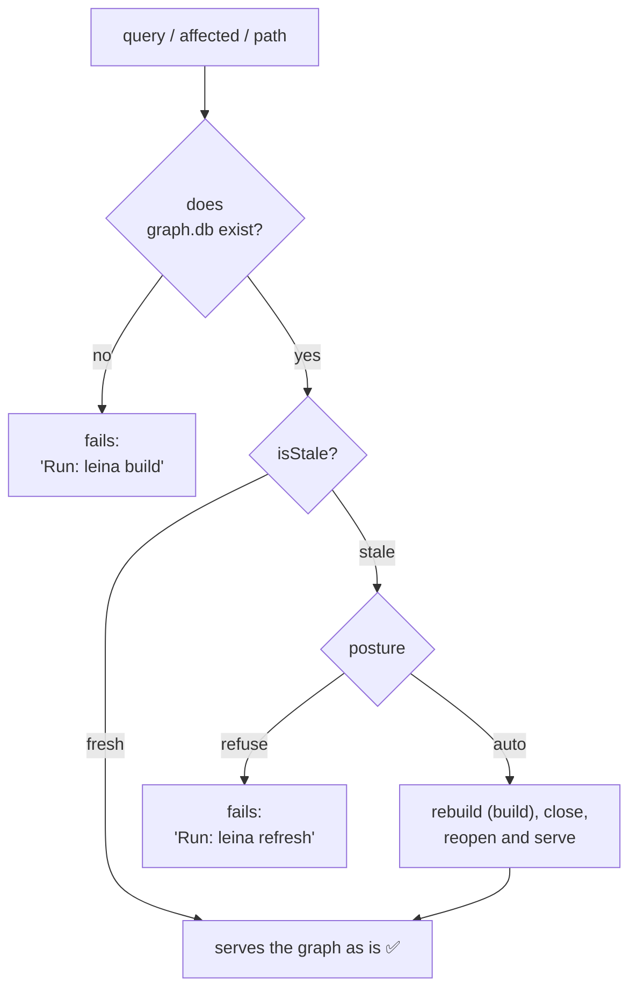

# 3. Search and queries over the graph

> **In one sentence:** on top of the cartographer's map, leina offers three questions —
> *"what's near this?"* (`query`), *"what breaks if I touch this?"* (`affected`) and
> *"how do I get from A to B?"* (`path`)— plus a guardian that makes sure the map is up to date
> before answering.

All three are traversals (BFS) over the graph; they differ in *which direction* they walk and
*what stops them*.

---

## `query` — "what's around this topic?"

It's the GPS that, given a destination in natural language, shows you the neighborhood. It runs
four steps:

**1. Terms.** The question is split into words — camelCase and snake_case included
(`graphStore` → graph, store) — English and Spanish stopwords and meta words
("function", "code", "método"…) are dropped, and every word is **stemmed** the same way node
labels are, so *verified* meets `verify`, *anchors* meets `Anchor`, *confined* meets `confine`.

**2. Scoring.** Each node's label is split into words too; a module counts its **file name**
only, its directories being weak evidence. Per term:

| Term matches… | Weight |
|---|---|
| a label word | 1 |
| a label-word prefix (≥ 4 letters) | 0.6 |
| a word of the owner class (methods) | 0.5 |
| a directory word of the file | 0.3 |

Each weight is multiplied by the term's **IDF** over the graph's own vocabulary — a word that
appears in hundreds of labels (`get`, `graph`) counts little, a rare one (`confine`) decides.
The sum is scaled up by how much of the question the node covers and how much of its label
is made of question words, so `resolveHookProjectRoot` beats `resolve()` for "how does the
hook resolve the project root". An identifier written in the question (`openFreshStore`), or
a one-word question, gets an exact-name bonus — an ordinary English word never does. Modules
weigh less than functions/classes, and **test/mock/fixture nodes are penalised** unless you
pass `--include-tests` (MCP `includeTests`) or the question is about tests.

**3–4. Seeds and neighbourhood.** Up to 3 seeds, then a best-first expansion: each node
proposes at most 8 semantic neighbours (calls and implements first, then references, uses,
imports…), ranked by their own relevance and weighted by the strength of the node that
proposes them; `contains`/`method` are followed only from a module/class/interface into
members that are themselves relevant (at most 4). A seed's file-mates are never pulled in just
for sharing its file, and test nodes stay out of the expansion by default. The output lists
every node with its `file:line` and the non-structural edges with the line where each happens.

> **Why this isn't vector RAG:** a vector store answers "what *resembles* this?". `query`
> answers "what is *connected* to this, and how?". For code, the second question is the one
> that matters.

---

## `affected` — "what breaks if I touch this?" (blast radius)

Before renaming or migrating a symbol, you want to know **who depends on it**. `affected` runs
a **backward** BFS: it starts at the seed node and walks **only inbound edges** (`inEdges`),
level by level, up to `depth` (3 by default).

**Which node is the seed?** The argument is matched exactly — a name, `Class.method`,
`path:name` or a node id (see the [CLI reference](../CLI_REFERENCE.md#selecting-a-symbol-affected-path-impact-analyze)).
A name shared by several nodes resolves deterministically (production code before tests and
mocks, functions/classes before types before modules) and the other candidates are listed so
you can pick one; a name that matches nothing exactly is never swapped for a lookalike — you
get suggestions and a non-zero exit instead. `path` and `impact analyze` resolve their
symbols the same way.

Two rules make the result **trustworthy**:

1. **Only certain relations propagate impact**: `calls`, `references`,
   `imports`, `imports_from`, `inherits`, `extends`, `implements`, `overrides`, `uses`. A
   `contains` or `method` edge (purely structural) doesn't count as "affects you".
2. **`AMBIGUOUS` edges do NOT propagate.** A blast radius has to be trustworthy; a guessed
   edge points at an arbitrary candidate, so it's ignored. (This is where distinguishing
   `EXTRACTED`/`INFERRED`/`AMBIGUOUS` at extraction time pays off — see
   [The graph](./02-grafo.md#el-edge-la-calle).)

**Interfaces are followed.** In a hexagonal codebase most calls target a *port*
(`MemoryRepository.search`), not the adapter that runs (`SQLiteMemoryRepository.search`).
So when the walk reaches a method that `implements` an interface member — or `overrides` a
base method, transitively — the callers of that member count as dependents at the same depth,
tagged `via` the member (the CLI prints `[calls via MemoryRepository.search()]`). Sibling
implementations of the same member are not dependents, and a class-level
`class implements Interface` edge is not lifted (that would make every type reference to the
interface depend on the class). The other direction comes for free: an interface member's
incoming `implements` edges make its implementations dependents.

Each hit reports the `node`, the `depth` at which it was reached, the `viaRelation`, the
`target` it depends on and the `site` — the `file:line` of the edge itself (the call site),
which is what the CLI prints. Over MCP, `graph_affected` sends each hit compacted to
`{id, label, kind, at, depth, relation, target, via?}`, with `at` = that call site.

---

## `path` — "how does A connect to B?"

`path` is a BFS over the **undirected view** (looks at both out and in edges), capped at
8 hops. It keeps track of each node's predecessor; as soon as it touches the destination, it
reconstructs the chain of steps backward.

It's useful for answering "how does the CLI reach the database?" by showing the concrete chain
of calls/imports that links the two ends. Returns `null` if there's no path within the limit.
Because the walk is undirected, each step records whether its edge points forward or backward,
and the output draws the arrow that way: `A <--calls-- B` means B calls A.

---

## The *freshness gate*

Here's the magic that avoids answering with a stale map. The cartographer saved, at build time, a
**manifest** with the fingerprint of every source file. Before each read, a guardian compares the
current state against that fingerprint.

### How the map is detected as stale

The staleness check compares the current sources against the manifest and returns at the
**first** sign of staleness (so the reason is deterministic):

The fine detail: a newer `mtime` alone **isn't enough** to declare staleness. It's confirmed with the
**content hash** (SHA-256). That way, a `git checkout` or a "save without editing" that only
touches the `mtime` but leaves the content unchanged does **not** trigger an unnecessary rebuild.

The manifest also records what the map was drawn **with**, not only from: the leina version, the
extractor schema version and a fingerprint of every resolution config (`tsconfig*.json`,
`jsconfig.json`, `package.json`). After an upgrade the map is stale even if no source changed —
the new extractors may draw it differently — and an edited `paths` map or `exports` field is
stale too, because it re-routes imports without touching any source. The same comparison is what
tells an incremental build it must re-extract everything instead of reusing per-file results.

### Auto vs refuse: the *posture*

When the map is stale, what do we do? The gate decides based on the configured *posture*:

- **`auto`** (default): rebuilds on its own, warns via `stderr` and answers with the fresh map.
  The writer and the reader never coexist (build → close → reopen).
- **`refuse`**: doesn't touch anything; tells you to run `leina refresh` yourself.

Several processes can find the same map stale at the same moment — four agents' queries right
after an edit, an MCP server next to a CLI. Only one redraws it: rebuilds of a project take a
lock (`.leina/graph.build.lock`), the others wait for it and then look again, and if the map is
fresh by then they answer from it instead of redrawing it themselves. Four concurrent stale
queries cost one rebuild, not four (on a ~790-file repo: ~1.5 GB of combined peak memory
instead of ~4.4 GB).

The `import()` of the build stack is **dynamic** and only happens on the `auto` branch when needed:
that way, the common path (fresh map) never loads the heavy extraction stack, and that's why a
`query` starts up in ~0.15s.

> **Refresh via hook:** besides this gate, the `PostToolUse` hook triggers
> `leina refresh` when the agent edits or writes files — see
> [Hooks and injection](./06-hooks-e-inyeccion.md). Between the gate and the hook, the map stays
> up to date without anyone having to think about it.

---

## To continue

- The repo's other employee, the librarian → [Project memory](./04-memoria.md)
- How `affected` is used to validate stale notes → [Graph–memory communication](./05-comunicacion-grafo-memoria.md)
