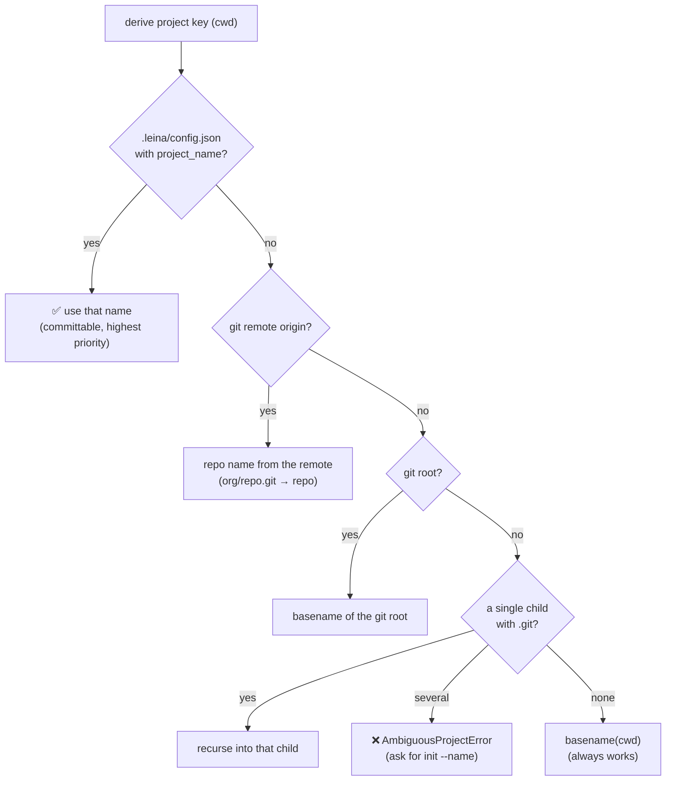
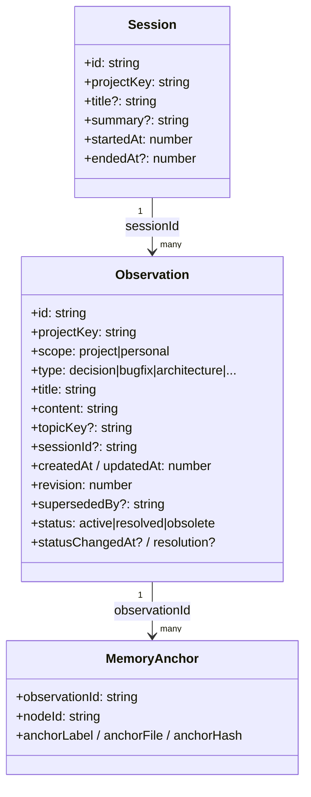
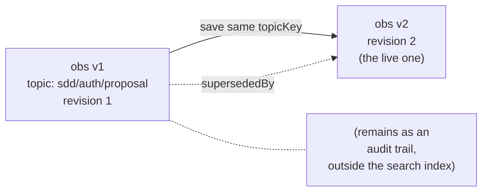
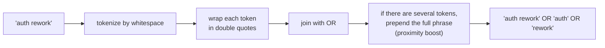

# 4. Project memory

> **In one sentence:** memory is the project's *logbook* — it records decisions, resolved
> bugs, and conventions so the AI doesn't have to rediscover them every session — and it
> lives in **a single global database** segmented by project.

The graph knows *what* the code IS. Memory knows *why* it ended up that way. It's the
difference between reading a building's blueprint and reading the architect's notes on why
they moved that column.

---

## Where it lives and how it's segmented

Unlike the graph (one `graph.db` per repo), **all** memory lives in a single global
database: `~/.leina/memory.db`. There's no need to initialize the project; memory is
always-on.

So how do projects avoid getting mixed together? Through the **project key**: a stable
label that segments each observation. It's like a shared diary where each project has its
own tab.

### Deriving the project key

The project key is derived with a **fail-open cascade**: it uses the first source that works.

The result is normalized: NFKC, lowercase, path separators → `-`, collapsing non-alphanumerics
into a single `-`. **Important:** project keys use **hyphens**, not underscores (unlike the
graph's node IDs, which use `_`). That keeps the two namespaces separate.

If the `cwd` is not a git repo and there are **several** child repos, an
`AmbiguousProjectError` is thrown: you need to fix the name with `leina init --name <name>`
(which writes the committable `config.json`).

**Subdirectories and worktrees share the repo's key.** The `config.json` lock is looked up
from the `cwd` upwards to the enclosing git toplevel (never past it: a nested repo is its own
project; outside git only the `cwd` itself counts), and a **linked worktree** — a sibling
`git worktree add ../feature`, or a `.claude/worktrees/<name>` checkout — without its own
lock uses the main worktree's. The git-root step likewise names a linked worktree after its
main worktree, so every worktree of a repo keys the same. Before 3.0 a subdirectory missed a
root-level lock and a remote-less worktree keyed by its own directory name; memories saved
under such a key can be moved with `leina memory merge-projects`.

---

## The model: observations and sessions

### The `observation` (a diary entry)

It's a dated, **typed** fact about the project. The `type` classifies its nature:

| `type` | What it's for |
|--------|----------|
| `decision` | a design decision and its reasoning |
| `bugfix` | a bug and how it was fixed |
| `architecture` | a structural description |
| `discovery` | a non-obvious finding |
| `pattern` | a recurring pattern in the code |
| `config` | something about configuration |
| `preference` | a team/user preference |
| `manual` | a free-form note |

The list is **closed**: a write with any other `type` (or an unknown `scope`) is rejected with
an error that lists the valid values. Databases written before 3.0 could hold free-form types
(the CLI used to accept anything); the v6 migration rewrites them once — `note`, `reference`,
`suggestion` and `project` → `discovery`, anything else → `manual`, unknown scopes → `project` —
and `memory import` maps the same legacy aliases, so old exports still load.

This `type` distinction reappears in [drift detection](./05-comunicacion-grafo-memoria.md):
some types are *descriptive* (they expire when the code changes) and others *normative*
(rules that keep holding even as the code moves).

### The `topicKey` and upsert (evolving an entry in place)

If you save an observation with a `topicKey` (a stable slug like
`sdd/auth-rework/proposal`) and later save another one with the **same** `topicKey`, the old
one is **not** deleted: it's marked `supersededBy` (it remains as an audit trail) and the
new one takes its place with an incremented `revision`. It's a diary where you can *edit a
page* without losing the earlier versions.

### The `status` (an entry's lifecycle)

A diary fills up with things that were true once: a backlog item that has since shipped, a
bug note whose fix landed. Deleting them loses history; leaving them live makes the agent act
on them. Each observation therefore carries a **status**:

| `status` | Meaning | Injected / `memory context` | `search` / `verified` / `get` |
|----------|---------|-----------------------------|-------------------------------|
| `active` (default) | still applies | yes | yes |
| `resolved` | done / fixed — kept for history | **no** | yes, labelled and ranked lower |
| `obsolete` | no longer true or no longer relevant | **no** | yes, labelled and ranked lower |

`leina memory resolve [<dir>] <id> [--note "..."] [--obsolete]` closes an entry (a `--batch`
form closes many at once), `memory reopen` brings it back, and `memory update --status` /
MCP `memory_update {status, resolution}` set it directly. A status change records its date
(`statusChangedAt`) and the optional note (`resolution`) but **does not touch `updatedAt`**:
closing an old note never pushes it to the top of anything ordered by recency. Re-saving the
same `topicKey` starts a fresh, active revision (the snapshot keeps the old status).

The status is independent of the drift state (next chapter): a resolved note can still have
fresh anchors, and an active one can be stale; `verified` reports both, and its verdict honours
both — a resolved note is at best `WARNING`, an obsolete one `DO NOT USE`.

### The `session` (a work shift)

Groups observations from a single work session (`startedAt`/`endedAt`). At the end of a
session, `leina memory session [<dir>] --content "..."` saves a summary.

---

## How it's stored (the `memory.db`)

Memory is persisted over SQLite through the `MemoryRepository` port. The schema has four
pieces:

| Table | What it stores |
|-------|-----------|
| `sessions` | sessions (indexed by `project_key, started_at DESC` for recency) |
| `observations` | the diary entries; `topic_key` with a **partial** unique index (only live rows, `superseded_by IS NULL`) |
| `obs_fts` | virtual **FTS5** table for full-text search |
| `memory_anchors` | the sticky notes that link an observation to graph nodes (see [chapter 5](./05-comunicacion-grafo-memoria.md)) |

### FTS5: full-text search

`obs_fts` is a virtual FTS5 table in *external-content* mode that indexes `title` and
`content`. Two tokenizer details matter:

- **porter** (English stemming): "running" matches "run".
- **unicode61 + remove_diacritics**: accent-insensitive search — key for writing the diary
  in Spanish ("migración" matches "migracion").

**Live-only index:** only **live** observations (`superseded_by IS NULL`) enter the index.
Superseded versions remain in the base table (for audit) but **never score** in searches.
Triggers guard INSERT/UPDATE/DELETE to maintain that invariant — including a row that changes
side (a live row retired by a `merge-projects` topic collision or an import conflict leaves
the index; a snapshot revived by an import re-enters it). Before 3.0 that transition had no
trigger and left "ghost" index entries; the v8 migration rebuilds the index once to purge them.

---

## How it's searched (BM25)

Search runs an FTS5 query ranked by **BM25**. What's interesting is how the query is
**sanitized** before being sent to FTS5:

The strategy is **recall-first**: joining with `OR` makes it match any term, and BM25 sorts
the best hits first. The full phrase as an extra term gives a boost to documents where the
words appear together.

BM25 only builds the **candidate pool**; the final order is one ranking shared by both back
ends (FTS5, and the `LIKE` fallback for SQLite builds without it):

1. **Exact hits before prefix-fallback hits.** When the exact hits do not fill the page
   (`--limit`), each token is cut to ~60% and then to 4 chars (`paginacion` → `pagina*`,
   `pagi*` → finds `pagination`) and those hits fill the rest of the page — always below.
2. **Active before resolved/obsolete** notes (they stay findable, just demoted).
3. **Relevance + match boosts:** normalised BM25 (or, in `LIKE` mode, a BM25-style score
   computed in JS with the same 5× title weight), plus an exact `topicKey` match (+5), a query
   that names the topic's family or leaf (+1.5 — `release` → `release/2-1-0-status`), the
   phrase in the title (+1) or every token in it (+0.5), the phrase in the content (+0.3), and
   a small recency prior (+0.3, 90-day half-life).
4. Ties: newest first, then id — the order never depends on the SQLite build.

Every comparison is **accent- and case-insensitive** in both modes (`publicacion` =
`publicación`; `LIKE` folds through a `leina_fold()` SQL function). Each `SearchHit`
carries `id`, `title`, `type`, `topicKey`, `status`, a `snippet`, the final `score` (higher
is better) and `updatedAt`.

Read commands:

- `leina memory search [<dir>] "<query>"` — raw search (the above).
- `leina memory context [<dir>]` — recent sessions + latest **active** observations.
- `leina memory verified [<dir>] "<query>"` — search **+ drift check** against the graph.
  That's exactly the subject of the next chapter.

---

## Up next

- How the librarian knows a note has gone stale → [Graph–memory communication](./05-comunicacion-grafo-memoria.md)
- How this diary gets injected into the agent without it having to ask → [Hooks and injection](./06-hooks-e-inyeccion.md)
