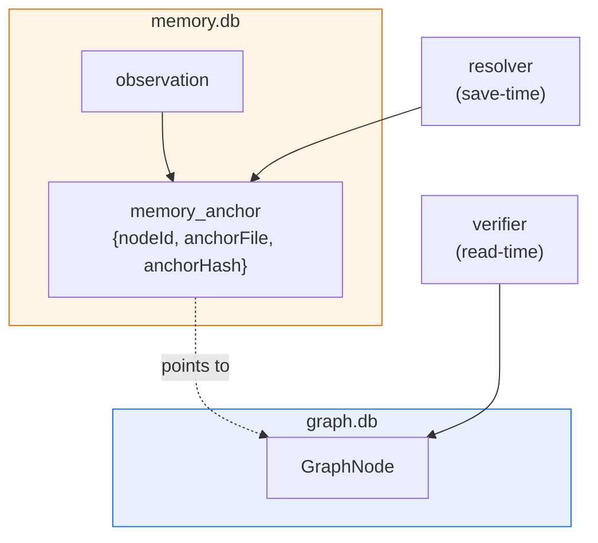
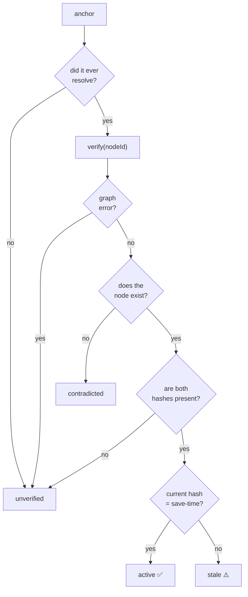
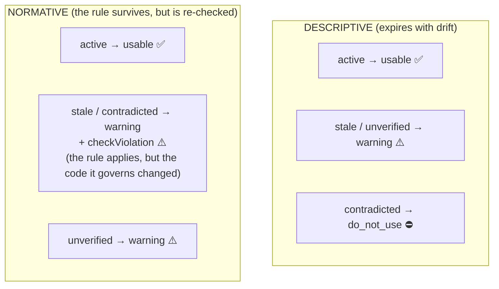
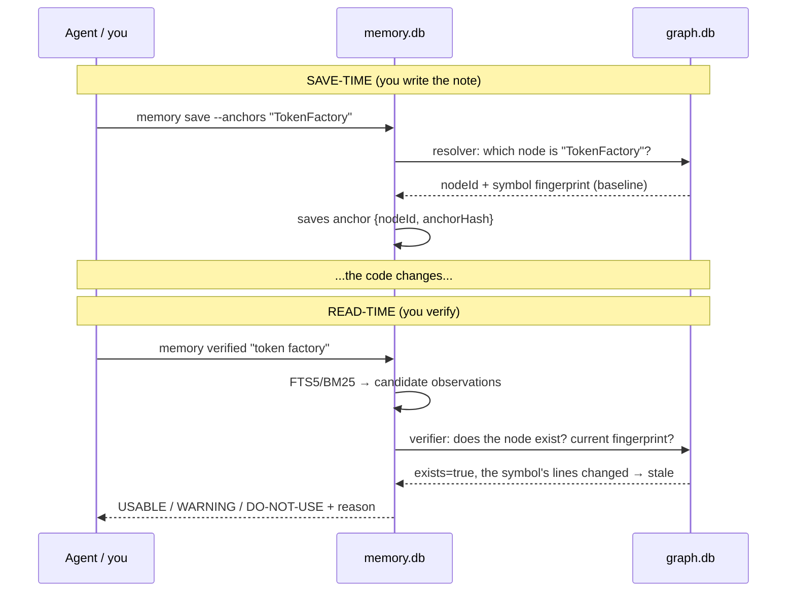

# 5. How the graph and memory talk to each other (drift detection)

> **In one sentence:** memory observations get "pinned" to graph nodes with *sticky notes*
> (`anchors`); when the code changes, leina compares the saved state against the
> live graph and classifies each note as **USABLE**, **WARNING**, or **DO-NOT-USE**.

This is the chapter where the cartographer and the librarian finally shake hands.

---

## Two separate databases, one conversation

Remember: the graph (`graph.db`, per repo) and memory (`memory.db`, global) are
**decoupled on disk**. Memory never touches the graph store directly. They come together in the
**application layer**, at the composition root, which hands memory two functions that *know* how
to talk to the graph: a **resolver** (to pin sticky notes) and a **verifier** (to check them).

The graph is opened **lazily**: only if anchors are actually exercised *and* a `graph.db` exists. If
there's no graph, anchors are left unresolved (`unverified` state) and nothing breaks.

---

## The sticky note: how an anchor gets pinned

Think of an anchor as an adhesive note stuck to a page of a book that keeps getting rewritten. When you
save an observation with `--anchors "TokenFactory"`, at **save-time** the following happens:

1. The graph is searched for the node(s) whose label matches **exactly** (functional-exact, no
   fuzzy substring) `"TokenFactory"`.
2. For each match, a **fingerprint** is taken from the working tree:
   - a **symbol fingerprint** (`sym1:<sha256>`) of the symbol's *own lines* — whenever the node
     has a start line (`sourceLocation`) in a language with a span rule (TS/JS, Java, C#, Go,
     Rust, C/C++, Kotlin, Swift, PHP… by brackets; Python by indentation);
   - otherwise the **whole file's** SHA-256 (module/config nodes, other languages), or the build
     manifest's hash when the file can't be read.
3. `memory_anchors` stores: `nodeId`, `sourceFile`, and that save-time `anchorHash`.

That fingerprint is the snapshot *at the moment you wrote the note*. It's the baseline against
which drift is later measured. If the label doesn't resolve (no graph, no match), the anchor is
still saved but without `nodeId` → it will remain `unverified`. **Fail-open:** any error returns
`[]`, and the save is never broken.

**How the symbol's lines are found.** The graph records only where a symbol *starts*
(`"L42"`). The span is derived from the source: the symbol's name is looked up on that line (or
the nearest line naming it, so a graph built a few edits ago still lands on it), then scanned to
the end of its declaration — matching brackets while skipping strings, comments and regex
literals, or the indented block for Python. The fingerprint hashes those lines trimmed, without
blank lines: re-indenting is not drift, any token change is. The span is a heuristic, but a
deterministic one, so save-time and read-time fingerprints differ only when the symbol's own
text changed.

---

## The review: detecting drift at read-time

When you run `leina memory verified`, the librarian reviews each sticky note
**at the moment of reading** (the result is never persisted). For each anchor, the verifier
asks the graph: *does this node still exist? what is its current fingerprint on disk?* — the
symbol's lines for a `sym1:` anchor, the whole file for a file-level one. And the anchor state is
decided:

The four states (`MemoryState`):

| State | Meaning | The sticky note... |
|--------|-----------|---------------|
| `active` | the node exists and **its fingerprint is unchanged** | is still stuck on, and current |
| `stale` | the node exists but **the symbol changed** (or can no longer be located in its file); for a file-level anchor, **the file changed** | is still stuck on, but the page was rewritten |
| `contradicted` | the node **no longer exists** in the graph | the page was torn out |
| `unverified` | it never resolved to a node, or the graph isn't available | we don't know which page it was against |

When an observation has **several** anchors, the aggregation takes the worst case
(`contradicted` > `stale` > `unverified` > `active`) — with one exception: a whole-file anchor
into a file the same note also pins *symbols* of (`src/cli/doctor.ts` next to `checkHooks`) does
not count as `stale`. The symbols decide; an edit elsewhere in that file is not drift for the note.
(A node that is gone still counts.)

### Upgrading pre-3.0 anchors: `memory reanchor`

Before 3.0 every anchor stored the whole file's hash, so any edit anywhere in the file flagged
the note. `leina memory reanchor <dir>` upgrades those anchors in place to symbol fingerprints
**without moving their baseline**: the saved hash identifies one exact version of the file — the
working tree when it is unchanged, otherwise a commit found by walking that file's history on
any ref (newest first, last 300 commits) — and the symbol is fingerprinted *in that version*.
An upgraded anchor reads `active` only if the symbol itself is unchanged since the note was
saved. Anchors whose version can't be found, and module/config anchors, stay file-level.
`--dry-run` reports what would change.

The same command also mints anchors from the backticked code references in each note
(`` `openFreshStore` ``, `` `src/cli/wiring.ts` ``, `` `src/a.ts:helper` ``) when one resolves
to exactly one node. It skips identifiers shorter than 3 characters and generic words (`get`,
`query`, `foo`, `npm`…), prefers production code over tests when a name matches both, and never
anchors a bare name to test code alone — qualify it (`test/x.test.ts:helper`) to mean it.

---

## The verdict: descriptive vs normative

Here's the most important subtlety. Not all notes age the same way:

- A **descriptive** note ("this module caches sessions in memory") describes *what the*
  code *is like*. If the code changed, the description **has expired**.
- A **normative** note ("NEVER log the token in plaintext") is a *rule*. Even if the code
  changes, the rule **still holds** — in fact, if the code has drifted, what you want is to check
  that it hasn't been *violated*.

The observation's `type` defines its `nature`: types like `architecture`/`bugfix` are
**descriptive**; `decision`/`preference` are **normative**. The final classification
crosses `nature` × `state` to produce a `verdict`:

A drifted rule is never discarded, but it is not served as `usable` either (before 3.0 it was):
the code it governs changed, so the agent is told to check it was not violated.

The note's **lifecycle status** (`active` / `resolved` / `obsolete`, see
[Memory](./04-memoria.md)) is a second, independent axis: it is reported next to the drift
`state` — never folded into it — and it caps the verdict. A `resolved` note is history, not
current truth, so it is at best a `warning`; an `obsolete` one is always `do_not_use`.

| Verdict | What it tells the agent |
|-----------|------------------------|
| `usable` | trust this note |
| `warning` | use it with caution; it may be outdated or couldn't be verified |
| `do_not_use` | this description no longer applies; ignore it |

The verified context builds the full response: it looks up the observations that match the query,
derives each one's state against the live graph, and sorts them into `usable` / `warning` /
`doNotUse` with their reason. That way the agent doesn't just receive *what* was noted, but *how much
it can trust* each note today.

---

## The full cycle, end to end

> **Why read-time and not persisted:** the drift state is derived on the fly. That keeps
> memory fresh without constant re-checks, and it means the *same* note can go from
> `usable` to `stale` simply because the code changed — without touching the memory database.

---

## Up next

- How all this intelligence reaches the agent without being asked for it → [Hooks and injection](./06-hooks-e-inyeccion.md)
- Where the `affected` you should run before migrating comes from → [Search and queries](./03-busqueda-y-consultas.md#affected--qué-se-rompe-si-toco-esto-blast-radius)
