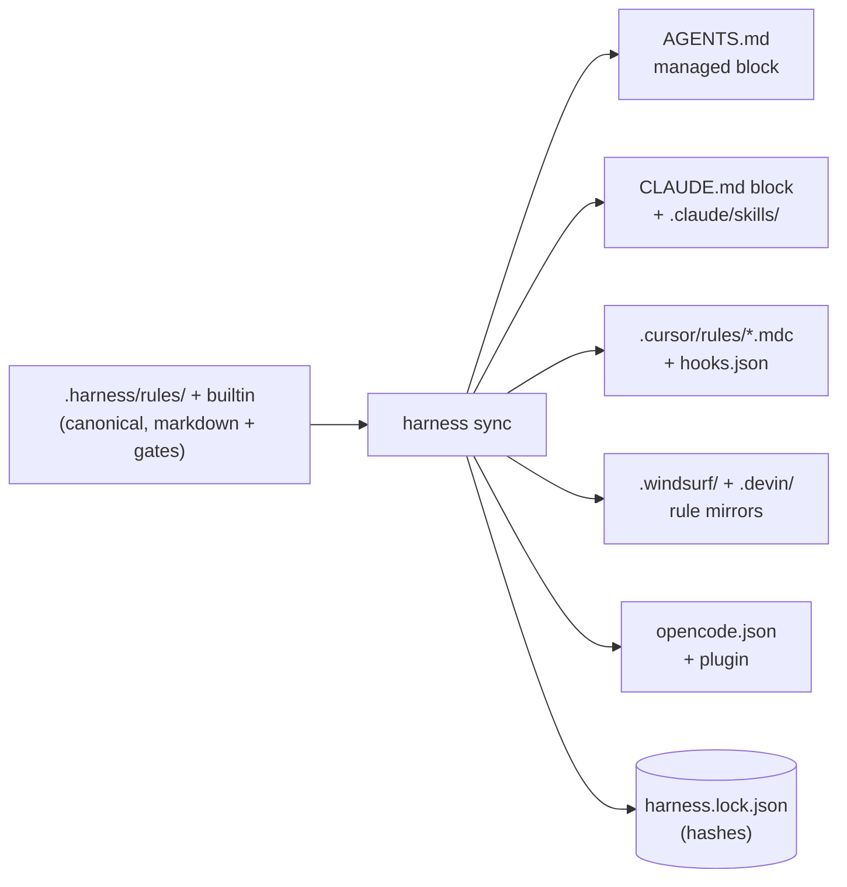

# The harness — rules with executable gates

> **The employee:** the **site inspector**. The cartographer knows what the code IS, the
> librarian knows WHY it got that way — the inspector makes sure a job is **declared
> before it starts and verified before it is called done**. Unlike the concierge (the
> hooks, who only leave notes), the inspector can refuse to sign off.

---

## Why a harness

Instructions to an agent ("run the tests", "stay in scope", "don't commit secrets") are
text — the model can ignore, forget, or rationalize around them. The harness turns each
of those instructions into two coupled halves:

- a **markdown body** the model reads (the *why* and the *how*), and
- an optional **gate** the machine executes (the *proof*).

"The tests must pass" stops being prose and becomes `npm test` exiting 0, checked by a
process the model cannot argue with. That is the entire design in one sentence: **advice
for the model, evidence for the machine.**

### Turning it on

The harness is **opt-in**. `leina init --harness` seeds `.harness/config.json` and runs the
sync (`--harness-preset generic|leina-native` implies `--harness`); a plain `leina init`
leaves `.harness/` alone. A repo that already carries `.harness/config.json` — seeded
earlier, written by `leina tui`, or committed by a teammate — keeps being synced by every
`init`. `leina harness ...` commands work on any repo either way. Independently of the
seed, a trusted workspace always gets the integrity seal on `.harness/` rules/config (see
below).

## The model

### Rules

A rule is a markdown file with JSON frontmatter, resolved from three layers:

| layer | where | wins over |
|---|---|---|
| `builtin` | shipped with leina (`assets/harness/rules/`) | — |
| `project` | `<repo>/.harness/rules/` | builtin |
| `user` | `~/.leina/harness/rules/` | project — **except weakening** |

Each rule declares an `id` (`namespace/slug`), a lifecycle `phase`
(`intake → plan → execute → verify → deliver`), a `severity` (`blocking` | `advisory`),
an optional `scope` (`paths`, `taskTypes`, `languages`) and zero or more gates.

Gates are declared in rule files only. The config layers
(`~/.leina/harness/config.json` < `.harness/config.json` < `.harness/config.local.json`)
tune a rule through `rules.<id>` entries that accept just `enabled` and `severity`; a
`gate` key there is a validation error — verify exits 2 and the hooks fail closed until
it is fixed.

**The enforceability invariant:** the *baseline* is what the shared layers enforce — the
builtin or project rule file plus the project `.harness/config.json`. The personal layers
(user rule files, user config fields the project does not re-set, `config.local.json`)
can *replace* or tune a rule, but against a blocking, enabled baseline they can never
**disable** it, **demote** it to advisory, or change its gate, phase or scope. The attempt
is ignored and reported as a warning. Likewise `strictness` comes from the project (or
the default `guided`), and the personal layers can only raise it to `strict`. Guardrails
that any layer could switch off would not be guardrails.

### Gates

Six executable gate types, run by an engine with a bounded parallel pool, per-gate
timeouts and **fail-closed** semantics (`fail`, `error` and `timeout` all count as a
blocking failure when the rule is blocking):

| gate | proves |
|---|---|
| `command` | a shell command exits with the expected code (and stdout matches, optionally) |
| `file` | a file exists / matches / has minimum size (e.g. `plan.md` before coding) |
| `diff` | the git diff stays inside the contract's declared scope |
| `diff-content` | no **added** line matches a forbidden pattern (secrets, `.only`/`.skip`) — including in files not yet `git add`-ed |
| `checklist` | every acceptance criterion is checked off |
| `js` | anything else — a repo-local module returns `{ pass, message }` |

`onlyIfChanged` globs let a gate skip itself when nothing relevant changed, which keeps
`verify` fast on docs-only tasks.

A `js` gate's module is resolved according to the rule that declares it: builtin and user
rules load it only from next to their own rule file; project rules look repo-relative
first, then next to the rule file — absolute paths are rejected, and the real path
(symlinks resolved) must stay inside the repo. Rule-supplied regexes are time-bounded:
the `file` gate's `contentMatch` / `contentNotMatch`, like `diff-content`'s `forbidAdded`
and `command`'s `expectStdoutMatch`, run under the gate's timeout capped at 5 s, and
running out is an `error`.

### The contract

The piece that inverts the burden of proof. Before a non-trivial task, the agent (or
you) declares:

```bash
leina harness contract new --goal "Add the export endpoint" --type feature \
  --scope "src/routes/**" --scope "test/**" \
  --criterion "endpoint covered by a failing-first test"
```

The contract records the git HEAD at declaration time (`baseRef`). From then on the
agent's **own declaration is the objective boundary**: the `diff` gate fails on any file
outside the declared scope, and widening the scope requires an explicit
`contract edit --add-scope` — visible, auditable, never silent. Closing the task
(`contract end`) archives the whole state to `.harness/state/history/`.

The declaration happens *before* the work, when there is no incentive to cheat; the
verification happens *after*, when there is no way to.

### Recipes

Golden-path procedures (`add-endpoint`, `fix-bug`) — parameterized step lists that start
with a contract and end with `verify` + `contract end`. Only their terminal gates are
enforceable; their value is variance reduction: the agent follows a known-good sequence
instead of improvising one.

## The completion wall

`leina harness verify` is the single oracle, with an exit-code contract every transport
shares:

- `0` — every blocking gate passed; the task may be called complete;
- `1` — blocking failure; the report says exactly what and why;
- `2` — the harness itself is misconfigured (invalid rule, broken config), or the call is
  malformed (an unknown `--rule` id, a flag without its value, an unknown sub-command).

Only a **full** run — no `--rule`, phases covering `verify` and `deliver` — speaks for the
task: it alone writes `.harness/state/current/verify-report.json`, the report the commit
guard reads. A filtered run prints a note on stderr and is not recorded, so
`verify --rule <something green>` can never unlock a commit. A known rule that does not
apply to the run is a warning, and `--json` carries `loadErrors`, so a config error never
reads as an empty green report.

The changed files come from `git diff --relative` against the contract's `baseRef` (or
the merge-base with the default branch), relative to the harness root: in a monorepo
package with its own `.harness/`, paths are package-relative and changes outside the
package are ignored. Outside a git repository (or when git is unavailable) the changed
set is *unknown*, not empty, and verify **fails closed** with a warning: `onlyIfChanged`
gates run instead of skipping, path/language scoping is not applied, and blocking
`diff-content` gates — and `diff` gates with a scope to check — report an error. A non-git
directory has to disable `harness/no-secrets` to go green.

On hosts with hooks, the **stop hook** judges the current tree every time the agent tries
to end its turn. It **reuses the last full verify** when that report provably still holds —
same `HEAD`, same `worktree` fingerprint, and the same rules, config, contract and
workspace trust (a digest recorded with the report) — and runs a fresh verify otherwise.
So a turn that changed nothing since the last verify does not pay for the whole suite
again, while any edit, commit, contract or rule change re-runs it. A filtered run is never
recorded, so it is never reused. A pass allows the stop; a failure comes back as the
agent's next instruction (block) — a reused failure says so, and points at
`leina harness verify` for fixes made outside the tracked tree (dependencies, git-ignored
files, the leina graph or memory), which the fingerprint cannot see. `maxRetries` (1–10,
default 3; `contract new` rejects anything else, CLI and MCP alike) caps the blocks of one
**stop chain** — from the first attempt to end the turn until a stop is allowed; a reused
failure counts exactly like a fresh one. At the cap the hook **yields honestly**, naming
the rules that failed for this very tree: "allowing stop so a human can look", never a
fake green. A pass or a yield resets the count, and so does a new chain
(`stop_hook_active: false`, or a `UserPromptSubmit`); if the counter cannot be saved, the
stop yields rather than loop unbounded.

The pre-bash hook refuses `git commit` / `git push` while the recorded report shows
blocking failures — or, in strict mode, while there is no fresh report — and the pre-edit
hook keeps the agent inside the contract scope. Freshness is content-based: verify
records a `worktree` fingerprint — the changed-file set against the base it used, plus a
per-file identity (sha256 of the content; size + mtime past the hashing caps of 8 MiB per
file and 64 MiB in total; identities for the first 2000 files, the full path list always
compared; `.harness/state/` and `.leina/` excluded) — and the guard recomputes it. A
read-only `git status` keeps the report fresh; any content change stales it, and a report
without a fingerprint (an older leina) always counts as stale. When the config cannot be
read, both hooks **fail closed**: edits outside `.harness/state/` and commit/push are
blocked, naming the config error.

**Integrity boundary — and the threat model, stated honestly:** what defines the gates is
agent-read-only — `.harness/rules/`, `.harness/config.json`, `.harness/config.local.json`
and the lockfile, plus, outside the repo, the user layer `$LEINA_HOME/harness/**` and the
trust store `$LEINA_HOME/trust/**` (checked by path, symlinks resolved). The pre-edit hook
seals the Edit/Write tool path in *every* strictness mode. The pre-bash hook reads each
simple command (split on `;`, `&&`, `||`, `|`, `&`, `(`, `)` and backticks, following
`cd`, `sh -c` and `eval`) and blocks it only when a path it **writes** is protected —
anything under `.harness/` except `state/`, or the user harness / trust store spelled as
`~/.leina/…` or `$LEINA_HOME/…`: redirection targets; the operands of `rm`, `mv`, `tee`,
`touch`, `ln`, `chmod` and kin; the destination of `cp` / `install` / `rsync`; files
edited in place by `sed -i` / `perl -i`; `dd of=`; paths given to `git checkout` /
`restore` / `rm` / `mv` / `reset`. A read that merely mentions one
(`cat .harness/config.json`, a `grep` redirected elsewhere, a commit message naming
`.harness`) passes. Task state (`.harness/state/` — plan, checklist, contract) stays
agent-writable: that is the surface the workflow needs.

Be clear about what this is: the harness is a **guardrail against accidents and drift,
not a sandbox against an adversarial agent**. A model determined to cheat can still
reach the files through channels no hook can fully parse (variable indirection, a quoted
`$(…)`, a git alias such as `git ci`, an interpreter like `python -c …`, a script it
writes and runs). The guarantees that do **not** depend on agent cooperation are the ones
anchored outside the conversation: `verify`'s exit code, the lockfile hashes, and
`sync --check` in CI. If you need hard isolation, run the agent in a sandbox — the
harness will still be the thing that tells you *whether the work is done*, which no
sandbox does.

## Workspace trust — what may run unattended

Hooks and automated verify run code that travels with the repo (`command` gates, `js`
modules), so no committed file can be what lets them run. Trust is recorded **outside the
repo**, at `$LEINA_HOME/trust/<sha256 of the repo root's realpath>`: `leina init` (FULL and
LIGHT) writes the record once consent is enabled and prints a `workspace trust` line,
`leina deinit` removes it, and `leina repair` deliberately never grants it. A workspace
is trusted when its record exists and `.leina/consent` is not `disabled`. A committed
`.leina/consent` grants nothing, and a moved or re-cloned repo is a different workspace:
run `leina init` on it again on that machine. A subdirectory and the repo's own worktrees
(nested under `.claude/worktrees/` or linked elsewhere) share the repo's trust; a nested
independent clone or a submodule does not inherit it.

In an untrusted workspace every automated path is a silent no-op, never an error:

- the agent gate (`leina agent-hook`): no harness enforcement and no SessionStart
  contract/rule injection — and none of its advisory work either (no memory/graph context
  injection, no background self-heal build on SessionStart);
- `leina harness hook <event>` does nothing (`cursor-shell` answers `allow`);
- the MCP tool `harness_verify` returns `{ skipped: true, reason }`;
- in any verify, the `js` / `command` gates of **project**-layer rules are skipped with a
  visible result. A human running `leina harness verify` still gets a report, and
  builtin/user rules — shipped with leina or kept in your home — still run their gates.

`leina doctor` shows it as **workspace trust**: ok when trusted; a warning when consent is
enabled but this machine holds no record (re-run `leina init <root>`); info when consent
is disabled or the repo was never initialized. The consent flag keeps its tri-state
meaning (`unknown` / `enabled` / `disabled` — the `leina-setup` prompt reads it, and
`disabled` always wins); trust is what lets anything run.

## One rule set, many hosts

`leina harness sync` compiles the canonical rules into whatever each platform can
enforce:



Four properties make this safe to re-run forever:

1. **Evidence-based targeting.** A platform is only written when config or flags name it,
   or the repo already carries its files. leina never elects an AI host for you.
   `--platforms a,b` regenerates only the named platforms and leaves the others'
   artifacts alone (an unknown id exits 2, listing the valid ones). `leina init --hosts …`
   in a repo whose config has no `platforms` pins it to those hosts' platforms plus
   whatever the lockfile and auto-detection already govern, so pinning never drops one.
2. **Managed blocks + lockfile.** Harness co-owns files like `CLAUDE.md` via marked
   blocks; everything outside the markers is never touched. Every artifact's hash lives
   in `.harness/harness.lock.json` — a hand-edited artifact **conflicts** (kept intact,
   reported) instead of being clobbered; `--force` is the explicit override. Orphans (a
   rule or platform removed) are deleted or stripped and reported as `removed`, including
   orphaned harness entries in shared JSON (Cursor hooks, OpenCode instructions).
3. **Symmetric removal.** `leina deinit` walks the same lockfile in reverse: owned files
   deleted only when untouched, blocks stripped only when their interior is untouched,
   harness entries removed from shared JSON files (user entries survive verbatim; a file
   without harness entries stays byte-identical, an edited one keeps its formatting, and
   every rewrite is atomic). The `.harness/config.json` init wrote goes only while it is
   unchanged (its sha256 is kept in `.leina/harness-config.sha256`) or still `{}`, and an
   emptied `.harness/` is pruned.
4. **Committed inputs, contained outputs.** Sync compiles only the committed layers —
   builtin and project rules plus `.harness/config.json`. Personal rules, the user config
   and `config.local.json` govern verify and the hooks on your machine but never land in
   synced files (their `platforms` / `hookCommand` are ignored by sync). Lockfile paths
   must be repo-relative: an absolute, `..`, NUL or `.git` path invalidates the whole
   lockfile, and a path that resolves outside the repo through a symlink is refused
   (reported as a sync error or a deinit failure), never followed.

Enforcement differs per host — Claude Code, Devin/Windsurf and OpenCode get blocking
hooks, Cursor gets advisory hooks plus a shell guard (integrity seal + commit guard),
AGENTS.md-only hosts get instructions — but the **oracle is identical everywhere**:
whatever the host can or cannot enforce, `leina harness verify` exits 0 or it does not.

## Where things live

```
.harness/
├── config.json          # platforms, strictness (guided|strict), rule overrides, hookCommand
├── config.local.json    # personal layer — never synced, cannot weaken blocking rules
├── rules/               # project rules (override builtin by id)
├── harness.lock.json    # artifact hashes — the sync parity ledger
├── generated/           # host files harness owns outright (e.g. opencode rules)
└── state/               # task state, ignored by its own .gitignore (`*`)
    ├── current/         #   contract.json · checklist.md · plan.md · verify-report.json · retries.json
    └── history/<ts>/    #   archived contracts, one dir per ended task
```

`state/.gitignore` is created whenever the state dir is, so task state stays out of git
even in a repo `leina init` never touched. `verify-report.json` carries, besides the
report, the `changedFiles` it judged, the `worktree` fingerprint the commit guard
recomputes, and the `head` + `inputs` digest the stop hook checks before reusing it;
`retries.json` counts the blocks of the current stop chain. Outside the repo,
`$LEINA_HOME/harness/` (default `~/.leina/harness/`) holds the user rules and config, and
`$LEINA_HOME/trust/` the workspace trust records.

The leina-specific builtin rules (`leina-memory-first`, `leina-graph-consult`,
`leina-graph-fresh`, `leina-session-summary`) close the loop with the other two
employees: the inspector requires the agent to consult the librarian before starting,
keep the cartographer's map fresh, and leave the logbook entry before signing off.

## Rule presets — `generic` vs `leina-native`

Those four leina-coupled rules are **blocking by default**, and they only pass when leina
itself is adopted in the repo (graph built, memory in use). A team that wants the harness
for its *generic* value — tests-pass, no-secrets, diff-in-scope, lint-clean — should not
inherit four rules that fail unless they also run leina commands. Hence two presets
(defined in `application/harness/recipes.ts`):

| preset | what governs | `.harness/config.json` |
|---|---|---|
| `leina-native` | the full builtin suite, **including** the four `leina-*` rules — the historical default | `{}` — no rule overrides (the seed `leina init` writes, give or take a `platforms` pin) |
| `generic` | only the host-agnostic rules (`tests-pass`, `no-secrets`, `diff-in-scope`, `lint-clean`, `typecheck`, `no-skipped-tests`, `plan-before-code`, `criteria-checklist`, `contract-interview`, `changelog-updated`) — **no rule requires a leina command** | the config below |

A preset never edits the rule files — it is realized entirely through config overrides
(the project layer may disable builtin rules; only *user-local* layers are barred from
weakening, see the enforceability invariant). The `generic` preset is exactly:

```json
{
  "rules": {
    "harness/leina-graph-consult": { "enabled": false },
    "harness/leina-graph-fresh": { "enabled": false },
    "harness/leina-memory-first": { "enabled": false },
    "harness/leina-session-summary": { "enabled": false }
  }
}
```

`presetConfig("generic")` in `application/harness/recipes.ts` generates this file — it
derives the `leina-*` list by scanning the builtin rules at call time, so a new
leina-coupled rule automatically joins the preset's exclusion list. To adopt a preset,
pass `leina init --harness-preset generic|leina-native` (it implies `--harness`): it seeds
a **new** `.harness/config.json` (an existing one is left as it is, and the flag ignored
with a note). Otherwise write that JSON as your `.harness/config.json` by hand; keep (or reset
to) `{}` for `leina-native`.

## Vocabulary map — two hook vocabularies, one brain, three "gates"

The harness arrived from an origin framework, and part of its vocabulary landed
duplicated or overloaded. This section is the disambiguation table.

### Two hook-event vocabularies for the same lifecycle

There are two event vocabularies because there are two **transports**, not two engines:

- `leina agent-hook <Event>` — the host-neutral **agent gate** (chapter 6), speaking the
  `.devin/hooks.v1.json` event shape (`SessionStart`, `UserPromptSubmit`, `PreToolUse`,
  `PostToolUse`, `PostCompaction`, `Stop`). Installed by `leina init` for Claude Code and
  Devin/Windsurf.
- `leina harness hook <event>` — the harness's own hook CLI, with its own event names
  (`session-start`, `pre-edit`, `pre-bash`, `stop`, `cursor-*`, `idle`). Wired by
  `harness sync` for Cursor and OpenCode.

Both converge on the **same decision functions** in `application/harness/hooks.ts` — the
vocabularies differ, the brain does not:

| lifecycle moment | agent-gate event (`leina agent-hook`) | harness hook event (`leina harness hook`) | shared decision |
|---|---|---|---|
| session opens | `SessionStart` | `session-start` | inject contract status + intake rules |
| before a file edit | `PreToolUse` (tool `Edit`/`Write`/`MultiEdit`/`NotebookEdit`, or Devin `edit`/`write`) | `pre-edit` | `decidePreEdit` — contract scope + integrity boundary |
| before a shell command | `PreToolUse` (tool `Bash`, or Devin `exec`) | `pre-bash` | `decidePreBash` — commit/push guard + integrity boundary |
| agent tries to end the turn | `Stop` | `stop` | `decideStop` — last full verify if still valid, else a fresh one; allow, block, or yield at the `maxRetries` cap |
| after a tool ran | `PostToolUse` (advisory markers) | `cursor-after-edit` (edit ledger) | — |
| advisory-only moments | `UserPromptSubmit` / `PostCompaction` (context injection) | `cursor-stop` / `idle` | `advisoryVerifyFeedback` |
| Cursor shell permission | — | `cursor-shell` | `decideCursorShell` — exactly `decidePreBash`'s decision |

### Why enforcement is bifurcated per host

- **Claude Code and Devin/Windsurf** already run the agent gate that `leina init`
  installs. `harness sync` therefore ships them only rule **text** (the `CLAUDE.md`
  managed block + skills; `.devin/` + `.windsurf/` rule mirrors) — enforcement rides the
  gate that is already there. In a trusted workspace the gate **always** applies the
  integrity seal; full enforcement (contract scope, commit guard, Stop gate, SessionStart
  contract context) runs with an active contract, in strictness `strict`, or when the
  config cannot be read. Guided mode without a contract is otherwise advisory, and an
  untrusted workspace gets nothing at all.
- **Cursor and OpenCode** have no agent gate, so `harness sync` writes hook wiring that
  calls `leina harness hook <event>` directly. OpenCode's generated plugin turns exit
  status 2 into a hard block (a missing CLI, a timeout or any other status warns and
  allows); Cursor gets advisory hooks plus a shell permission guard that makes exactly
  the decision `decidePreBash` makes. The command they call is `hookCommand` (default
  `leina harness hook`), and only leina launch forms pass: `leina harness hook`; an
  absolute path to the leina binary + `harness hook`; or `node` (optionally with
  `--no-warnings` / `--experimental-strip-types`) + the absolute path of leina's
  `cli/index.{js,ts}` + `harness hook`. Shell metacharacters, quotes or an absolute path
  inside the repo make it a config error.

One brain, two doors: whichever transport fires, the decision comes from the same
functions, so hosts cannot drift apart in behaviour.

### The word "gate" means three different things

| name to prefer | what it is | where it lives | can it refuse? |
|---|---|---|---|
| **verify gates** (rule gates) | the executable proofs (`command`, `file`, `diff`, `diff-content`, `checklist`, `js`) run by `leina harness verify` — the completion wall | rule frontmatter + `application/harness/gates/` | yes — exit 1 blocks completion |
| **agent gate** (hook bridge) | the host-hook entry point `leina agent-hook`: injects context, and relays the harness decisions above to the host | `cli/agent-gate.ts` | only in a trusted workspace: writes to the integrity paths always; everything else with an active contract, `strict`, or an unreadable config — otherwise advisory |
| **freshness gate** (graph) | the staleness check the *graph* runs before answering a read — auto-rebuild or refuse (chapter 3); unrelated to the harness | graph read path | it refuses graph *reads*, never tasks |

In harness prose, a bare "gate" should mean a **verify gate**; qualify the other two.
