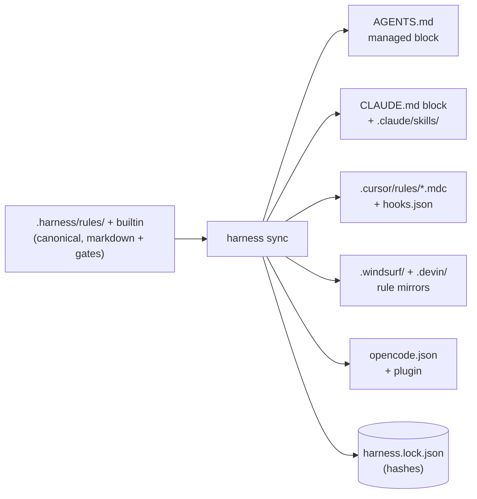

# The harness — rules with executable gates

> **The employee:** the **site inspector**. The cartographer knows what the code IS, the
> librarian knows WHY it got that way — the inspector makes sure a job is **declared
> before it starts and verified before it is called done**. Unlike the concierge (the
> hooks, who only leave notes), the inspector can refuse to sign off.

---

## Why a harness

Instructions to an agent ("run the tests", "stay in scope", "don't commit secrets") are
text — the model can ignore, forget, or rationalize around them. The harness turns each
of those instructions into two coupled halves:

- a **markdown body** the model reads (the *why* and the *how*), and
- an optional **gate** the machine executes (the *proof*).

"The tests must pass" stops being prose and becomes `npm test` exiting 0, checked by a
process the model cannot argue with. That is the entire design in one sentence: **advice
for the model, evidence for the machine.**

## The model

### Rules

A rule is a markdown file with JSON frontmatter, resolved from three layers:

| layer | where | wins over |
|---|---|---|
| `builtin` | shipped with leina (`assets/harness/rules/`) | — |
| `project` | `<repo>/.harness/rules/` | builtin |
| `user` | `~/.leina/harness/rules/` | project — **except weakening** |

Each rule declares an `id` (`namespace/slug`), a lifecycle `phase`
(`intake → plan → execute → verify → deliver`), a `severity` (`blocking` | `advisory`),
an optional `scope` (`paths`, `taskTypes`, `languages`) and zero or more gates.

**The enforceability invariant:** a user-local layer can *replace* a project rule, but it
can never **disable** a blocking rule or **demote** it to advisory. The attempt is
ignored with a warning. Guardrails that any layer could switch off would not be
guardrails.

### Gates

Six executable gate types, run by an engine with a bounded parallel pool, per-gate
timeouts and **fail-closed** semantics (`fail`, `error` and `timeout` all count as a
blocking failure when the rule is blocking):

| gate | proves |
|---|---|
| `command` | a shell command exits with the expected code (and stdout matches, optionally) |
| `file` | a file exists / matches / has minimum size (e.g. `plan.md` before coding) |
| `diff` | the git diff stays inside the contract's declared scope |
| `diff-content` | no **added** line matches a forbidden pattern (secrets, `.only`/`.skip`) — including in files not yet `git add`-ed |
| `checklist` | every acceptance criterion is checked off |
| `js` | anything else — a repo-local module returns `{ pass, message }` |

`onlyIfChanged` globs let a gate skip itself when nothing relevant changed, which keeps
`verify` fast on docs-only tasks.

### The contract

The piece that inverts the burden of proof. Before a non-trivial task, the agent (or
you) declares:

```bash
leina harness contract new --goal "Add the export endpoint" --type feature \
  --scope "src/routes/**" --scope "test/**" \
  --criterion "endpoint covered by a failing-first test"
```

The contract records the git HEAD at declaration time (`baseRef`). From then on the
agent's **own declaration is the objective boundary**: the `diff` gate fails on any file
outside the declared scope, and widening the scope requires an explicit
`contract edit --add-scope` — visible, auditable, never silent. Closing the task
(`contract end`) archives the whole state to `.harness/state/history/`.

The declaration happens *before* the work, when there is no incentive to cheat; the
verification happens *after*, when there is no way to.

### Recipes

Golden-path procedures (`add-endpoint`, `fix-bug`) — parameterized step lists that start
with a contract and end with `verify` + `contract end`. Only their terminal gates are
enforceable; their value is variance reduction: the agent follows a known-good sequence
instead of improvising one.

## The completion wall

`leina harness verify` is the single oracle, with an exit-code contract every transport
shares:

- `0` — every blocking gate passed; the task may be called complete;
- `1` — blocking failure; the report says exactly what and why;
- `2` — the harness itself is misconfigured (invalid rule, broken config).

On hosts with hooks, the **stop hook** runs verify when the agent tries to end its turn:
failures come back as the agent's next instruction (block), up to `maxRetries` times —
and then it **yields honestly**: "allowing stop so a human can look", never a fake green.
The pre-bash hook refuses `git commit` / `git push` while blocking gates are failing, and
the pre-edit hook keeps the agent inside the contract scope.

**Integrity boundary — and the threat model, stated honestly:** `.harness/rules/`,
`.harness/config.json` and the lockfile are agent-read-only: the pre-edit hook seals the
Edit/Write tool path in *every* strictness mode, and the pre-bash hook blocks the common
shell write forms (redirections, `sed -i`, `rm`, `tee`, …) against those paths. Task
state (`.harness/state/` — plan, checklist, contract) stays agent-writable: that is the
surface the workflow needs.

Be clear about what this is: the harness is a **guardrail against accidents and drift,
not a sandbox against an adversarial agent**. A model determined to cheat can still
reach the files through channels no hook can fully parse (variable expansion, exotic
quoting, a script it writes and runs). The guarantees that do **not** depend on agent
cooperation are the ones anchored outside the conversation: `verify`'s exit code, the
lockfile hashes, and `sync --check` in CI. If you need hard isolation, run the agent in
a sandbox — the harness will still be the thing that tells you *whether the work is
done*, which no sandbox does.

## One rule set, many hosts

`leina harness sync` compiles the canonical rules into whatever each platform can
enforce:



Three properties make this safe to re-run forever:

1. **Evidence-based targeting.** A platform is only written when config or flags name it,
   or the repo already carries its files. leina never elects an AI host for you.
2. **Managed blocks + lockfile.** Harness co-owns files like `CLAUDE.md` via marked
   blocks; everything outside the markers is never touched. Every artifact's hash lives
   in `.harness/harness.lock.json` — a hand-edited artifact **conflicts** (kept intact,
   reported) instead of being clobbered; `--force` is the explicit override.
3. **Symmetric removal.** `leina deinit` walks the same lockfile in reverse: owned files
   deleted only when untouched, blocks stripped only when their interior is untouched,
   harness entries removed from shared JSON files (user entries survive verbatim).

Enforcement differs per host — Claude Code and OpenCode get blocking hooks, Cursor gets
advisory hooks plus a commit guard, AGENTS.md-only hosts get instructions — but the
**oracle is identical everywhere**: whatever the host can or cannot enforce,
`leina harness verify` exits 0 or it does not.

## Where things live

```
.harness/
├── config.json          # platforms, strictness (guided|strict), rule overrides
├── rules/               # project rules (override builtin by id)
├── harness.lock.json    # artifact hashes — the sync parity ledger
├── generated/           # host files harness owns outright (e.g. opencode rules)
└── state/               # git-ignored task state
    ├── current/         #   contract.json · checklist.md · plan.md · verify-report.json · retries.json
    └── history/<ts>/    #   archived contracts, one dir per ended task
```

The leina-specific builtin rules (`leina-memory-first`, `leina-graph-consult`,
`leina-graph-fresh`, `leina-session-summary`) close the loop with the other two
employees: the inspector requires the agent to consult the librarian before starting,
keep the cartographer's map fresh, and leave the logbook entry before signing off.
