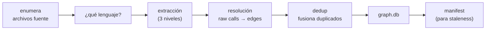
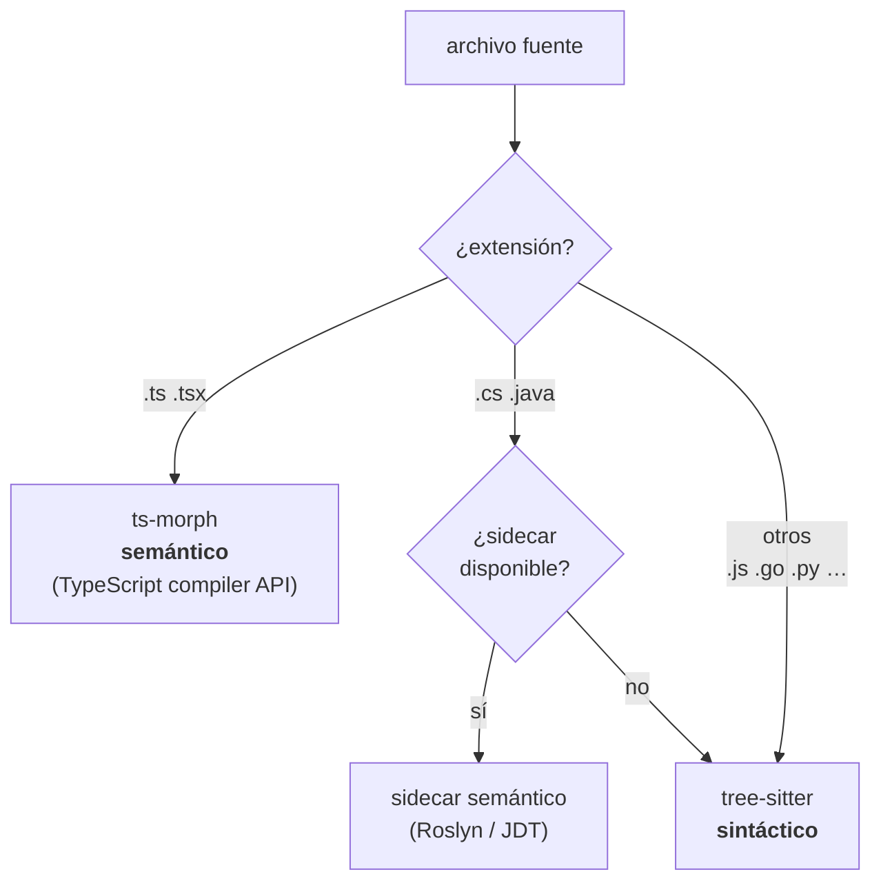
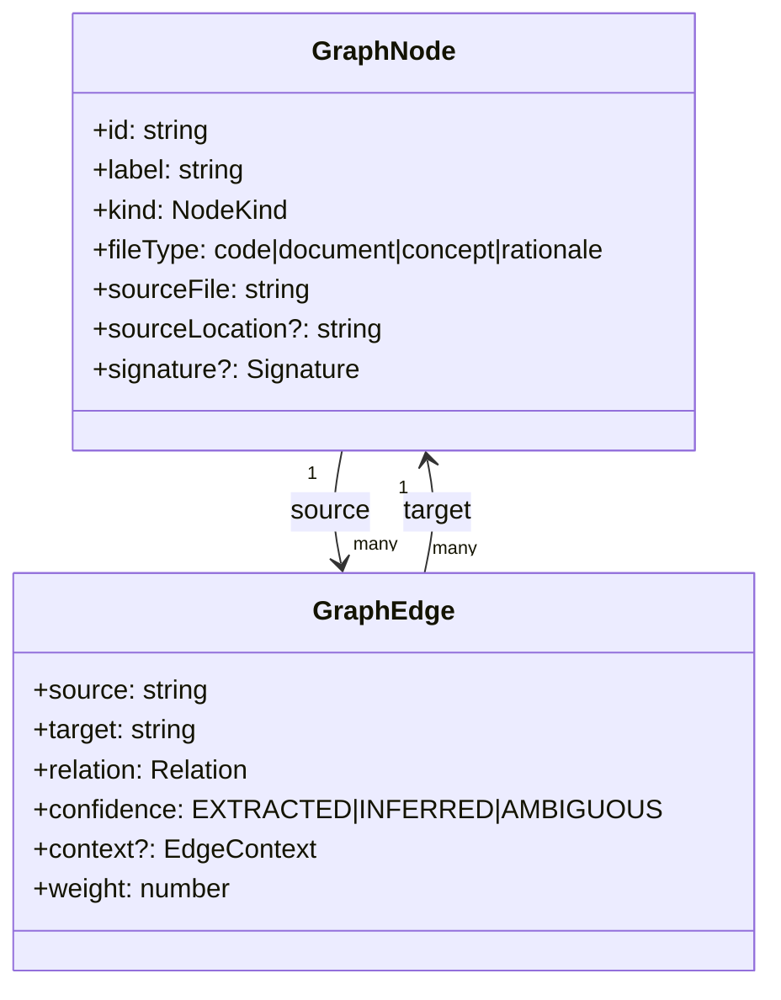
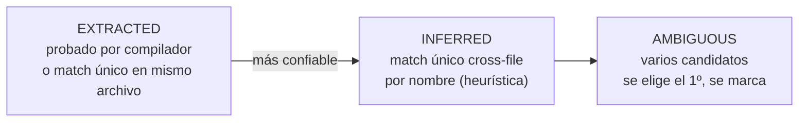
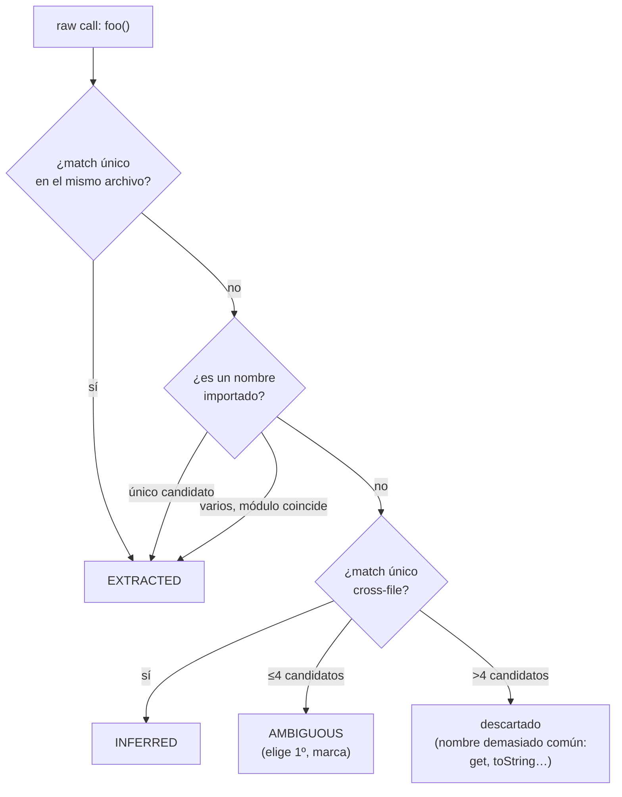

# 2. El grafo de código

> **En una frase:** el grafo convierte tu código (texto plano) en un *mapa de la ciudad* donde
> cada clase, función o método es una esquina (`node`) y cada llamada, herencia o import es una
> calle (`edge`).

---

## De texto plano a mapa de ciudad

Un repositorio es, para una máquina, una pila de strings. Buscar "quién usa `TokenFactory`"
con `grep` es como buscar una dirección leyendo todas las calles de la ciudad una por una.

El **cartógrafo** hace otra cosa: recorre el código una vez, dibuja un mapa, y desde entonces
responde "¿quién llega a esta esquina?" mirando el mapa, no las calles. Ese mapa es el grafo, y
vive en `<proyecto>/.leina/graph.db` (SQLite, uno por repo, git-ignored).

Construirlo es el comando `leina build` (o `refresh`).

---

## El pipeline de construcción



Tras volcar nodes y edges en SQLite, `build` escribe un **manifest** (huellas de los archivos
fuente) que después sirve para detectar si el mapa quedó viejo — ver
[Búsqueda y consultas](./03-busqueda-y-consultas.md#el-freshness-gate).

### Qué archivos cuentan como fuente

La lista de fuentes sigue la idea que el propio repo tiene de qué es el proyecto:

- **Dentro de git**, leina le pregunta a git: archivos rastreados más los no rastreados que
  **no están ignorados** (`git ls-files --cached --others --exclude-standard`). Lo que tu
  `.gitignore` excluye — `coverage/`, clientes generados, borradores locales — nunca se indexa.
- **Fuera de git** (o si git no está disponible), recorre el árbol de directorios.
- **En ambos casos** nunca entra en: otro repositorio o worktree enlazado anidado dentro del
  proyecto (un directorio con su propio `.git`); directorios ocultos (`.claude/`, `.idea/`,
  `.cache/`, …) **salvo** los de configuración de CI/entorno de desarrollo cuyo YAML lee el
  extractor de infra (`.github`, `.gitlab`, `.gitea`, `.forgejo`, `.circleci`, `.buildkite`,
  `.devcontainer`); directorios de build/dependencias (`node_modules`, `dist`, `build`,
  `vendor`, `target`, `obj`, `bin`, …); bundles minificados (`*.min.js`); symlinks.

Los worktrees de agentes como `.claude/worktrees/<nombre>/` son checkouts completos del repo:
antes de esta regla, indexarlos duplicaba cada símbolo. Un **workspace** multi-repo construye
cada miembro como su propia raíz (ver `leina workspace build`). Los submódulos de git también
son repositorios anidados: constrúyelos por separado.

---

## Extracción en tres niveles

No todos los lenguajes se leen igual. leina usa una estrategia escalonada que equilibra
**precisión** (grado de compilador) con **portabilidad** (sin dependencias nativas):



| Nivel | Lenguajes | Herramienta | Qué garantiza |
|-------|-----------|-------------|---------------|
| **Semántico (compiler-grade)** | TypeScript / TSX | **ts-morph** (TS compiler API) | Resolución exacta de símbolos: edges con confianza `EXTRACTED` |
| **Semántico (sidecar)** | C# / Java | proceso externo (Roslyn para C#, JDT para Java) | Igual de exacto; si no hay sidecar, **cae** a tree-sitter |
| **Sintáctico** | todo lo demás (JS, Go, Python, …) | **tree-sitter** | AST sin resolución; emite *raw calls* que se resuelven después |

### El sidecar de C#/Java

El cartógrafo no habla C# ni Java nativamente, así que para esos terceriza a un *sidecar*: un
proceso externo que recibe un directorio y devuelve `{ nodes, edges }` como JSON por stdout.
Se configura por variables de entorno:

```bash
LEINA_CSHARP_SIDECAR="dotnet /path/RoslynGraph.dll"
LEINA_JAVA_SIDECAR="java -jar /path/jdt-graph.jar"
```

Si no hay ninguno configurado, podés optar por que se construya on-demand
(`LEINA_BUILD_SIDECARS=1`): se materializan plantillas incluidas,
se compila con el toolchain local (dotnet SDK / JDK 17+) y el binario queda cacheado en
`~/.leina/sidecars/{lang}/dist/`. Sin sidecar, C#/Java se extraen igual con tree-sitter
(menos preciso, pero funciona).

### El truco de las dos pasadas (TypeScript)

Para TypeScript, la extracción recorre el proyecto **dos veces**:

1. **Pasada 1:** anota *todas* las declaraciones (funciones, clases, métodos). Arma la "guía
   telefónica".
2. **Pasada 2:** ahora que la guía está completa, resuelve cada llamada/herencia al nodo exacto.

¿Por qué dos? Porque TypeScript permite *forward references* y llamadas cruzadas entre
archivos: no podés resolver una llamada a algo que todavía no registraste.

Un renombre local se resuelve a la declaración que nombra: después de
`const { run } = await import("./jobs")`, `const run = jobs.run` o `const api = { run }`,
la llamada `run()` / `api.run()` es un edge `calls` al `run` de `jobs.ts`.

---

## El modelo: nodes y edges



### El `node` (la esquina)

- `id` — identificador **estable y file-scoped**. Normaliza cada parte (NFKC + casefold +
  colapsa no-alfanuméricos) y une con `:`; un miembro se acota con el id de su dueño. Ejemplo:
  `TokenFactory` en `src/auth.ts` → `src_auth_ts:tokenfactory`, y su método `create` →
  `src_auth_ts_tokenfactory:create`.
  El casefold puede hacer que dos declaraciones **distintas** de un mismo ámbito compartan id
  (`interface HostSpec` + `function hostSpec`, `class Parser` + `function parser`, un miembro
  estático y uno de instancia con el mismo nombre). La primera en orden de registro (clases,
  interfaces, funciones, consts con valor función, y después alias de tipo, enums y el resto
  de las variables de nivel superior) conserva el id
  plano; cada una de las siguientes recibe `:<tipo>` al final — `src_x_ts:hostspec:function`, o
  `src_x_ts:user:variable` para `const User` junto a `type User` — y
  luego `_2`, `_3`, … si también está ocupado. Las etiquetas de miembro son `method`, `static`,
  `accessor` y `static_accessor`. Las declaraciones de una misma entidad (fusión de interfaces,
  sobrecargas, un par get/set) comparten un solo nodo.
- `kind` — `class` · `function` · `method` · `interface` · `module` · `concept` y, para
  TypeScript, `type` (alias de tipo) · `enum` · `variable` (`const`/`let`/`var` de nivel
  superior que no es una función) · `accessor` (un par `get`/`set`). Los métodos de un objeto
  literal guardado en una variable de nivel superior son nodos `method` de esa variable, y una
  función o arrow anónima en `export default` es la función `default`. Los miembros de un
  contrato también son nodos `method`: los métodos y las propiedades de tipo función de una
  interfaz (`run: () => void`), y los métodos de un alias de tipo objeto
  (`type Port = { run(): void }`).
- `signature` — solo para funciones/métodos/accessors: tipo de retorno, parámetros (con tipo,
  nullabilidad, opcionalidad), modificador de acceso, flags `isAsync`/`isGenerator`.

### El `edge` (la calle)

Cada edge tiene una **relación** (el tipo de calle) y una **confianza** (cuán seguros estamos
de que la calle existe):

| Grupo | `relation` | Significa |
|-------|-----------|-----------|
| Estructural | `contains` | módulo → definición que vive en él |
| Estructural | `method` | clase → su método |
| Llamadas | `calls` | función → función que invoca |
| Llamadas | `references` | función → tipo, enum, constante o accessor que usa |
| Imports | `imports`, `imports_from` | dependencia de módulo |
| Herencia | `extends`, `implements`, `inherits` | jerarquía de tipos; en TypeScript `implements` también une cada miembro con el miembro del contrato que implementa (`MemoryStore.load → Store.load`, incluidos miembros heredados de interfaces y objetos literales tipados) |
| Herencia | `overrides` | miembro → el miembro más cercano de la clase base al que sobrescribe (TypeScript, miembros de instancia) |
| Otros | `uses` | uso genérico |

**Confianza** (`confidence`) — clave para entender la búsqueda después:



---

## Resolución: de *raw calls* a *edges*

tree-sitter no resuelve símbolos: cuando ve `factory.make()`, solo sabe que hay una llamada a
algo llamado `make`. Eso es un **raw call**. Convertirlos en edges reales es trabajo de la fase
de **resolución**, en dos pasos:

1. **Retarget de herencia** — los edges `extends`/`implements`/`inherits` apuntan al principio
   a IDs placeholder por etiqueta; se reapuntan al nodo real buscando el label en el índice
   (solo tipos: clases/interfaces, ignorando homónimos de métodos como constructores Java).
2. **Resolución de raw calls** — para cada llamada se buscan candidatos por label normalizado y
   se aplican heurísticas **en orden**:



**Desambiguación por tipo de receptor:** si tree-sitter pudo rastrear que `factory` es de tipo
`TokenFactory`, entonces `factory.make()` se resuelve directo a `TokenFactory.make()` sin
adivinar.

---

## Deduplicación

Antes de volcar a SQLite, una fase de **deduplicación** limpia:

- **Nodes** — por `id` (last-write-wins).
- **Edges** — por la tupla `(source, target, relation, context)`. Si hay multi-edges, se
  conserva el de **mayor confianza** (`EXTRACTED` 3 > `INFERRED` 2 > `AMBIGUOUS` 1) y se
  acumula `weight`. Los self-loops (`source === target`) se descartan.

---

## Cómo se guarda (el `graph.db`)

El grafo se guarda en SQLite con este schema:

```sql
CREATE TABLE nodes (
  id TEXT PRIMARY KEY,
  label TEXT NOT NULL,
  file_type TEXT NOT NULL,
  kind TEXT,
  source_file TEXT NOT NULL,
  source_location TEXT,
  community INTEGER,
  signature TEXT                -- Signature serializada como JSON
);

CREATE TABLE edges (
  source TEXT NOT NULL,
  target TEXT NOT NULL,
  relation TEXT NOT NULL,
  confidence TEXT NOT NULL,
  context TEXT NOT NULL DEFAULT '',
  source_file TEXT NOT NULL,
  source_location TEXT,
  weight REAL NOT NULL DEFAULT 1.0,
  PRIMARY KEY (source, target, relation, context)
);

CREATE INDEX idx_edges_source ON edges(source);   -- vecinos salientes rápidos
CREATE INDEX idx_edges_target ON edges(target);   -- vecinos entrantes rápidos
CREATE INDEX idx_nodes_label  ON nodes(label);    -- lookup por nombre
```

Decisiones a notar:

- **PK compuesta en `edges`** — `(source, target, relation, context)`: los multi-edges se
  fusionan acumulando `weight` (upsert con `ON CONFLICT`).
- **Índices en `source`/`target`** — son los que hacen baratos los recorridos del grafo
  (`outEdges`/`inEdges`), de los que depende toda la búsqueda del próximo capítulo.
- **`signature` como JSON** — se guarda como texto y se parsea al leer.

El schema se versiona internamente con `PRAGMA user_version`.

---

## Para seguir

- Ahora que el mapa existe, ¿cómo se consulta? → [Búsqueda y consultas](./03-busqueda-y-consultas.md)
- ¿Cómo se conecta este mapa con las notas del bibliotecario? → [Comunicación grafo–memoria](./05-comunicacion-grafo-memoria.md)
