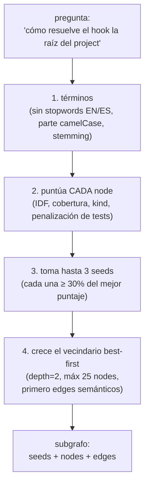
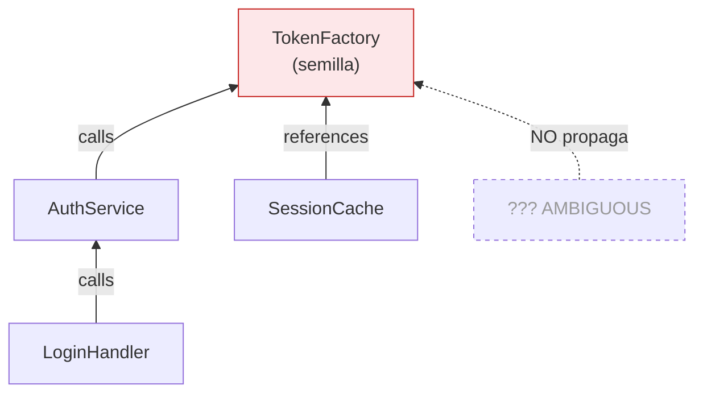
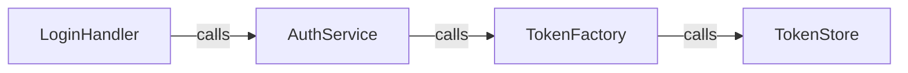
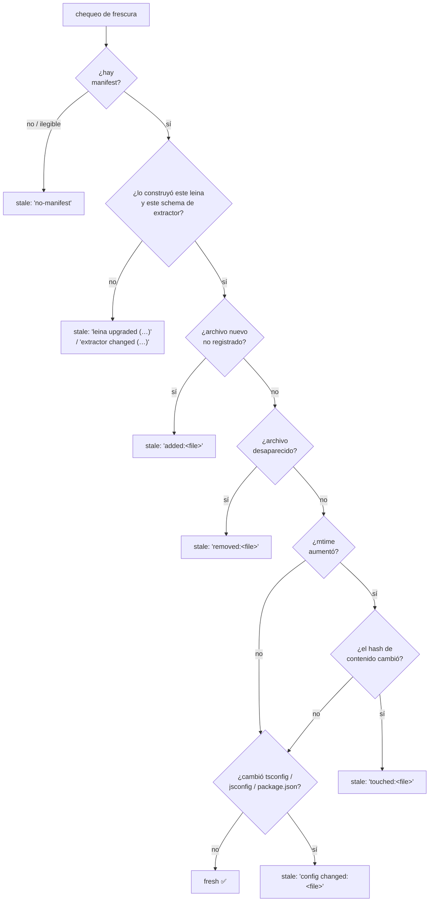
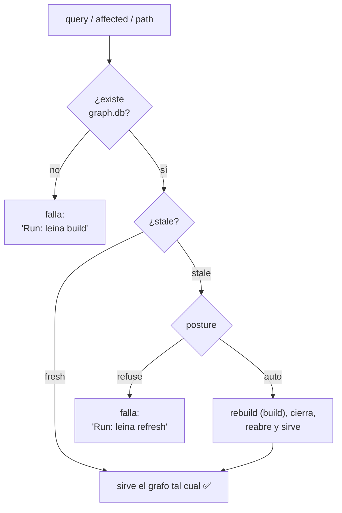

# 3. Búsqueda y consultas sobre el grafo

> **En una frase:** sobre el mapa del cartógrafo, leina ofrece tres preguntas —
> *"¿qué hay cerca de esto?"* (`query`), *"¿qué se rompe si toco esto?"* (`affected`) y
> *"¿cómo llego de A a B?"* (`path`)— y un guardián que se asegura de que el mapa esté al día
> antes de responder.

Las tres son recorridos (BFS) sobre el grafo; cambian en *qué dirección* caminan y *qué frenan*.

---

## `query` — "¿qué hay alrededor de este tema?"

Es el GPS que, dado un destino en lenguaje natural, te muestra el barrio. `query` hace
cuatro pasos:

**1. Términos.** La pregunta se parte en palabras — incluido camelCase y snake_case
(`graphStore` → graph, store) —, se descartan stopwords en inglés y español y palabras meta
("function", "code", "método"…), y cada palabra se reduce a su **raíz** igual que los labels,
así *verified* encuentra `verify`, *anchors* encuentra `Anchor` y *confined* encuentra `confine`.

**2. Scoring.** El label de cada node también se parte en palabras; un módulo cuenta solo su
**nombre de archivo**, sus directorios son evidencia débil. Por término:

| El término coincide con… | Peso |
|---|---|
| una palabra del label | 1 |
| un prefijo de palabra del label (≥ 4 letras) | 0.6 |
| una palabra de la clase dueña (métodos) | 0.5 |
| una palabra de directorio del archivo | 0.3 |

Cada peso se multiplica por el **IDF** del término sobre el vocabulario del propio grafo — una
palabra que aparece en cientos de labels (`get`, `graph`) pesa poco, una rara (`confine`)
decide. La suma escala según cuánto de la pregunta cubre el node y cuánto de su label está hecho
de palabras de la pregunta, así `resolveHookProjectRoot` le gana a `resolve()` para "how does the
hook resolve the project root". Un identificador escrito en la pregunta (`openFreshStore`), o
una pregunta de una sola palabra, recibe un bonus de nombre exacto — una palabra común en inglés
nunca. Los módulos pesan menos que funciones/clases, y **los nodes de test/mock/fixture se
penalizan** salvo que pases `--include-tests` (MCP `includeTests`) o la pregunta sea sobre tests.

**3–4. Seeds y vecindario.** Hasta 3 seeds y luego una expansión best-first: cada node propone
como mucho 8 vecinos semánticos (primero calls e implements, después references, uses,
imports…), ordenados por su propia relevancia y ponderados por la fuerza del node que los
propone; `contains`/`method` solo se siguen desde un módulo/clase/interfaz hacia miembros que
también son relevantes (como mucho 4). Los vecinos de archivo de una seed nunca entran solo por
compartir archivo, y los nodes de test quedan fuera de la expansión por defecto. La salida lista
cada node con su `file:line` y las edges no estructurales con la línea donde ocurre cada una.

> **Por qué no es RAG vectorial:** un vector store responde "¿qué se *parece* a esto?". `query`
> responde "¿qué está *conectado* a esto, y cómo?". Para código, la segunda pregunta es la que
> importa.

---

## `affected` — "¿qué se rompe si toco esto?" (blast radius)

Antes de renombrar o migrar un símbolo, querés saber **quién depende de él**. `affected` hace
un BFS **hacia atrás**: parte del nodo semilla y camina **solo por edges entrantes** (`inEdges`),
nivel por nivel, hasta `depth` (por defecto 3).

**¿Qué nodo es la semilla?** El argumento se matchea de forma exacta — un nombre,
`Clase.metodo`, `path:nombre` o un id de nodo (ver la [referencia de la CLI](../cli-reference.md#seleccionar-un-símbolo-affected-path-impact-analyze)).
Un nombre que comparten varios nodos se resuelve de forma determinista (código de producción
antes que tests y mocks, funciones/clases antes que tipos, antes que módulos) y se listan los
demás candidatos para que elijas uno; un nombre que no matchea nada exactamente nunca se
cambia por uno parecido — recibís sugerencias y un código de salida distinto de cero. `path`
e `impact analyze` resuelven sus símbolos de la misma forma.

Dos reglas hacen que el resultado sea **confiable**:

1. **Solo ciertas relaciones propagan impacto**: `calls`, `references`,
   `imports`, `imports_from`, `inherits`, `extends`, `implements`, `overrides`, `uses`. Un edge
   `contains` o `method` (puramente estructural) no cuenta como "te afecta".
2. **Los edges `AMBIGUOUS` NO propagan.** Un blast radius tiene que ser de fiar; un edge
   adivinado apunta a un candidato arbitrario, así que se ignora. (Acá se paga el haber
   distinguido `EXTRACTED`/`INFERRED`/`AMBIGUOUS` en la extracción — ver
   [El grafo](./02-grafo.md#el-edge-la-calle).)

**Se siguen las interfaces.** En un código hexagonal la mayoría de las llamadas apuntan a un
*port* (`MemoryRepository.search`), no al adaptador que se ejecuta
(`SQLiteMemoryRepository.search`). Así que cuando el recorrido llega a un método que
`implements` un miembro de interfaz — u `overrides` un método base, transitivamente — los
llamadores de ese miembro cuentan como dependientes a la misma profundidad, marcados `via` ese
miembro (la CLI imprime `[calls via MemoryRepository.search()]`). Las implementaciones hermanas
del mismo miembro no son dependientes, y un edge de clase `class implements Interface` no se
eleva (haría que toda referencia de tipo a la interfaz dependa de la clase). La otra dirección
sale gratis: los edges `implements` entrantes de un miembro de interfaz hacen dependientes a sus
implementaciones.

Cada hit reporta el `node`, la `depth` a la que se alcanzó, la `viaRelation`, el `target` del
que depende y el `site` — el `file:line` del propio edge (el call site), que es lo que imprime
la CLI. Por MCP, `graph_affected` envía cada hit compactado como
`{id, label, kind, at, depth, relation, target, via?}`, con `at` = ese call site.

---

## `path` — "¿cómo se conecta A con B?"

`path` es un BFS sobre la **vista no dirigida** (mira out *e* in edges), con tope de
8 saltos. Va guardando el predecesor de cada nodo; en cuanto toca el destino, reconstruye la
cadena de pasos hacia atrás.

Sirve para responder "¿cómo llega el login a la base de datos?" mostrando la cadena concreta de
llamadas/imports que une los dos extremos. Devuelve `null` si no hay camino dentro del límite.
Como el recorrido es no dirigido, cada paso registra si su edge apunta hacia adelante o hacia
atrás, y la salida dibuja la flecha en ese sentido: `A <--calls-- B` significa que B llama a A.

---

## El *freshness gate*

Acá está la magia que evita responder con un mapa viejo. El cartógrafo guardó, al construir, un
**manifest** con la huella de cada archivo fuente. Antes de cada lectura, un guardián compara el
estado actual contra esa huella.

### Cómo se detecta que el mapa quedó viejo

El chequeo de frescura compara las fuentes actuales contra el manifest y
devuelve al **primer** signo de obsolescencia (para que la razón sea determinista):

El detalle fino: un `mtime` más nuevo **no alcanza** para declarar stale. Se confirma con el
**hash de contenido** (SHA-256). Así, un `git checkout` o un "guardar sin editar" que solo
mueve el `mtime` pero deja el contenido igual **no** dispara un rebuild innecesario.

El manifest también registra **con qué** se dibujó el mapa, no solo a partir de qué: la versión de
leina, la versión del schema de extractores y una huella de cada config de resolución
(`tsconfig*.json`, `jsconfig.json`, `package.json`). Después de actualizar leina el mapa queda
stale aunque no haya cambiado ninguna fuente — los extractores nuevos pueden dibujarlo distinto —, y
un mapa `paths` o un campo `exports` editado también lo deja stale, porque redirige imports sin
tocar ninguna fuente. Esa misma comparación es la que le indica a un build incremental que debe
re-extraer todo en lugar de reutilizar resultados por archivo.

### Auto vs refuse: la *posture*

Cuando el mapa está stale, ¿qué hacemos? Lo decide el gate de frescura según la *posture*
configurada:

- **`auto`** (por defecto): reconstruye solo, avisa por `stderr` y responde con el mapa fresco.
- **`refuse`**: no toca nada; te dice que corras `leina refresh` vos mismo.

El pesado stack de extracción se carga solo cuando hay que reconstruir: así, el camino común
(mapa fresco) jamás lo paga, y por eso una `query` arranca en ~0.15s.

> **El refresh por hook:** además de este gate, el hook `PostToolUse` dispara
> `leina refresh` cuando el agente edita o escribe archivos — ver
> [Hooks e inyección](./06-hooks-e-inyeccion.md). Entre el gate y el hook, el mapa se mantiene
> al día sin que nadie lo piense.

---

## Para seguir

- El otro empleado del repo, el bibliotecario → [La memoria de proyecto](./04-memoria.md)
- Cómo `affected` se usa para validar notas viejas → [Comunicación grafo–memoria](./05-comunicacion-grafo-memoria.md)
