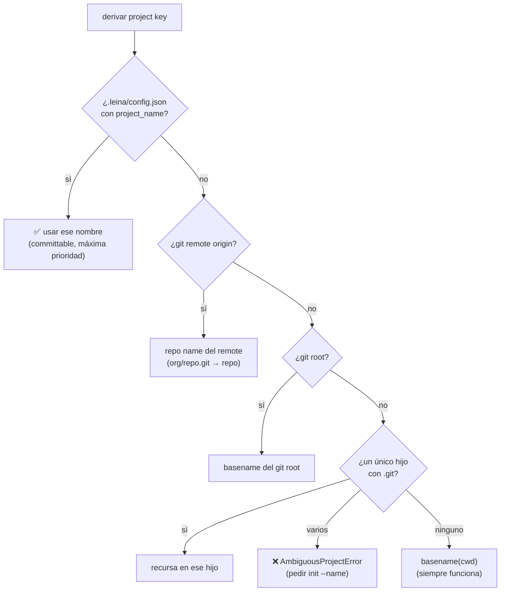
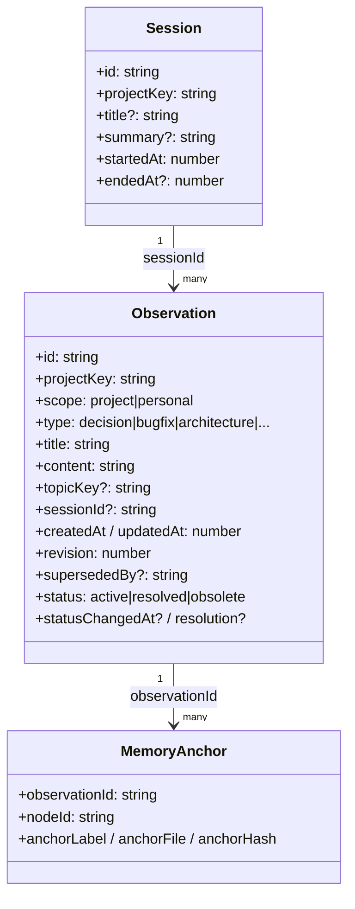
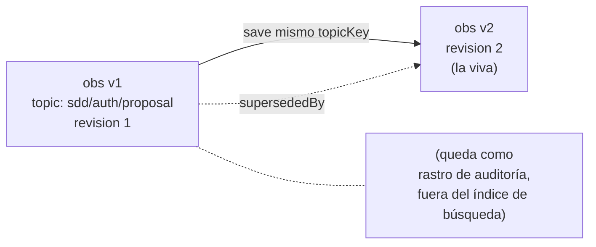
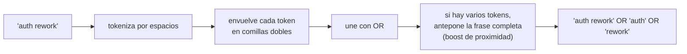

# 4. La memoria de proyecto

> **En una frase:** la memoria es el *diario de bitácora* del proyecto — anota decisiones, bugs
> resueltos y convenciones para que la IA no las re-descubra en cada sesión— y vive en **una
> sola base global** segmentada por proyecto.

El grafo sabe *qué ES* el código. La memoria sabe *por qué* llegó a ser así. Es la diferencia
entre leer el plano de un edificio y leer las notas del arquitecto sobre por qué movió esa
columna.

---

## Dónde vive y cómo se segmenta

A diferencia del grafo (un `graph.db` por repo), **toda** la memoria vive en una única base
global: `~/.leina/memory.db`. No se necesita inicializar el proyecto; la memoria es
always-on.

¿Cómo no se mezclan los proyectos entonces? Con el **project key**: una etiqueta estable que
segmenta cada observación. Es como un diario compartido donde cada proyecto tiene su propia
solapa.

### Derivación del project key

La derivación del project key baja por una **cascada fail-open**: usa la
primera fuente que funcione.

El resultado se normaliza: NFKC, minúsculas, separadores de path → `-`,
colapsa no-alfanuméricos a un solo `-`. **Importante:** los project keys usan **guiones**, no
guiones bajos (al revés que los IDs de node del grafo, que usan `_`). Eso mantiene los dos
namespaces separados.

Si el `cwd` no es un repo git y hay **varios** repos hijos, se lanza `AmbiguousProjectError`:
hay que fijar el nombre con `leina init --name <name>` (escribe el `config.json`
committable).

**Los subdirectorios y los worktrees comparten el key del repo.** El lock de `config.json` se
busca desde el `cwd` hacia arriba hasta el toplevel de git que lo contiene (nunca más allá: un
repo anidado es su propio proyecto; fuera de git solo cuenta el propio `cwd`), y un
**worktree vinculado** — un `git worktree add ../feature` hermano, o un checkout en
`.claude/worktrees/<name>` — sin lock propio usa el del worktree principal. El paso git-root
también nombra a un worktree vinculado por su worktree principal, así que todos los worktrees
de un repo comparten key. Antes de 3.0 un subdirectorio no veía el lock de la raíz y un
worktree sin remote tomaba el nombre de su propio directorio; las memorias guardadas bajo ese
key se pueden mover con `leina memory merge-projects`.

---

## El modelo: observations y sessions

### La `observation` (una entrada del diario)

Es un hecho fechado y **tipado** sobre el proyecto. El `type` clasifica la naturaleza:

| `type` | Para qué |
|--------|----------|
| `decision` | una decisión de diseño y su porqué |
| `bugfix` | un bug y cómo se resolvió |
| `architecture` | una descripción estructural |
| `discovery` | un hallazgo no obvio |
| `pattern` | un patrón recurrente del código |
| `config` | algo de configuración |
| `preference` | una preferencia del equipo/usuario |
| `manual` | nota libre |

La lista es **cerrada**: una escritura con cualquier otro `type` (o con un `scope`
desconocido) se rechaza con un error que lista los valores válidos. Las bases escritas antes de
3.0 podían tener tipos libres (el CLI aceptaba cualquier cosa); la migración v6 los reescribe
una sola vez — `note`, `reference`, `suggestion` y `project` → `discovery`, cualquier otro →
`manual`, scopes desconocidos → `project` — y `memory import` mapea los mismos alias heredados,
así que los exports viejos se siguen cargando.

Esta distinción de `type` reaparece en el [drift detection](./05-comunicacion-grafo-memoria.md):
algunos tipos son *descriptivos* (caducan cuando el código cambia) y otros *normativos* (reglas
que siguen valiendo aunque el código se mueva).

### El `topicKey` y el upsert (evolucionar una entrada en su lugar)

Si guardás una observación con un `topicKey` (un slug estable como `sdd/auth-rework/proposal`) y
después guardás otra con el **mismo** `topicKey`, la vieja **no** se borra: se marca
`supersededBy` (sigue como rastro de auditoría) y la nueva toma su lugar con `revision`
incrementada. Es un diario donde podés *editar una página* sin perder las versiones anteriores.

### El `status` (el ciclo de vida de una entrada)

Un diario se llena de cosas que fueron ciertas alguna vez: un ítem de backlog que ya se
publicó, la nota de un bug cuyo fix ya entró. Borrarlas pierde historia; dejarlas vivas hace
que el agente actúe sobre ellas. Por eso cada observación lleva un **status**:

| `status` | Significado | Inyectada / `memory context` | `search` / `verified` / `get` |
|----------|-------------|------------------------------|-------------------------------|
| `active` (por defecto) | sigue vigente | sí | sí |
| `resolved` | hecho / arreglado — se conserva como historia | **no** | sí, etiquetada y más abajo |
| `obsolete` | ya no es cierta o ya no importa | **no** | sí, etiquetada y más abajo |

`leina memory resolve <dir> <id> [--note "..."] [--obsolete]` cierra una entrada (la forma
`--batch` cierra varias de una vez), `memory reopen` la reabre, y `memory update --status` /
`memory_update {status, resolution}` por MCP lo fijan directamente. Un cambio de estado guarda
su fecha (`statusChangedAt`) y la nota opcional (`resolution`) pero **no toca `updatedAt`**:
cerrar una nota vieja nunca la sube al tope de nada ordenado por recencia. Volver a guardar el
mismo `topicKey` arranca una revisión nueva y activa (el snapshot conserva el estado viejo).

El estado es independiente del veredicto de drift (siguiente capítulo): una nota resuelta
puede tener anclas frescas y una activa puede estar stale; `verified` informa ambos.

### La `session` (un turno de trabajo)

Agrupa observaciones de una misma sesión de trabajo (`startedAt`/`endedAt`). Al final de una
sesión, `leina memory session <dir> --content "..."` guarda un resumen.

---

## Cómo se guarda (el `memory.db`)

La memoria se guarda en SQLite. El schema tiene cuatro piezas:

| Tabla | Qué guarda |
|-------|-----------|
| `sessions` | sesiones (indexada por `project_key, started_at DESC` para recencia) |
| `observations` | las entradas del diario; `topic_key` con índice único **parcial** (solo filas vivas, `superseded_by IS NULL`) |
| `obs_fts` | tabla virtual **FTS5** para búsqueda full-text |
| `memory_anchors` | los post-its que unen una observación con nodes del grafo (ver [cap. 5](./05-comunicacion-grafo-memoria.md)) |

### FTS5: la búsqueda full-text

`obs_fts` es una tabla virtual FTS5 en modo *external-content* que indexa `title` y `content`.
Dos detalles del tokenizer importan:

- **porter** (stemming en inglés): "running" matchea "run".
- **unicode61 + remove_diacritics**: búsqueda insensible a acentos — clave para escribir el
  diario en español ("migración" matchea "migracion").

**Triggers guardados:** solo las observaciones **vivas** (`superseded_by IS NULL`) entran al
índice. Las versiones superseded quedan en la tabla base (auditoría) pero **nunca puntúan** en
las búsquedas. Triggers dedicados custodian INSERT/UPDATE/DELETE para mantener esa invariante —
incluida una fila que cambia de lado (una fila viva retirada por una colisión de topic de
`merge-projects` o por un conflicto de import sale del índice; un snapshot revivido por un
import vuelve a entrar). Antes de 3.0 esa transición no tenía trigger y dejaba entradas
"fantasma" en el índice; la migración v8 reconstruye el índice una vez para purgarlas.

---

## Cómo se busca (BM25)

La búsqueda corre una query FTS5 rankeada por **BM25**. Lo interesante es cómo se **sanitiza**
la consulta antes de mandarla a FTS5:

La estrategia es **recall-first**: unir con `OR` hace que matchee cualquier término, y BM25
ordena los mejores hits primero. La frase completa como término extra le da un empujón a los
documentos donde las palabras aparecen juntas.

BM25 solo arma el **pool de candidatos**; el orden final es un ranking compartido por los dos
back ends (FTS5, y el fallback `LIKE` para builds de SQLite sin FTS5):

1. **Hits exactos antes que los del fallback por prefijo.** Si los hits exactos no llenan la
   página (`--limit`), cada token se corta al ~60% y después a 4 chars (`paginacion` →
   `pagina*`, `pagi*` → encuentra `pagination`) y esos hits completan la página — siempre debajo.
2. **Activas antes que resueltas/obsoletas** (siguen apareciendo, solo más abajo).
3. **Relevancia + boosts de match:** BM25 normalizado (o, en modo `LIKE`, un score estilo BM25
   calculado en JS con el mismo peso 5× del título), más un match exacto de `topicKey` (+5), una
   query que nombra la familia o la hoja del topic (+1.5 — `release` → `release/2-1-0-status`),
   la frase en el título (+1) o todos los tokens en él (+0.5), la frase en el contenido (+0.3) y
   un pequeño prior de recencia (+0.3, vida media de 90 días).
4. Empates: más nueva primero, después id — el orden nunca depende del build de SQLite.

Toda comparación es **insensible a acentos y mayúsculas** en ambos modos (`publicacion` =
`publicación`; `LIKE` pliega con una función SQL `leina_fold()`). Cada `SearchHit` trae `id`,
`title`, `type`, `topicKey`, `status`, un `snippet`, el `score` final (más alto es mejor) y
`updatedAt`.

Comandos de lectura:

- `leina memory search <dir> "<query>"` — búsqueda cruda (lo de arriba).
- `leina memory context <dir>` — sesiones recientes + últimas observaciones **activas**.
- `leina memory verified <dir> "<query>"` — búsqueda **+ chequeo de drift** contra el
  grafo. Eso es justo el tema del próximo capítulo.

---

## Para seguir

- Cómo el bibliotecario sabe que una nota quedó vieja → [Comunicación grafo–memoria](./05-comunicacion-grafo-memoria.md)
- Cómo se inyecta este diario al agente sin que lo pida → [Hooks e inyección](./06-hooks-e-inyeccion.md)
