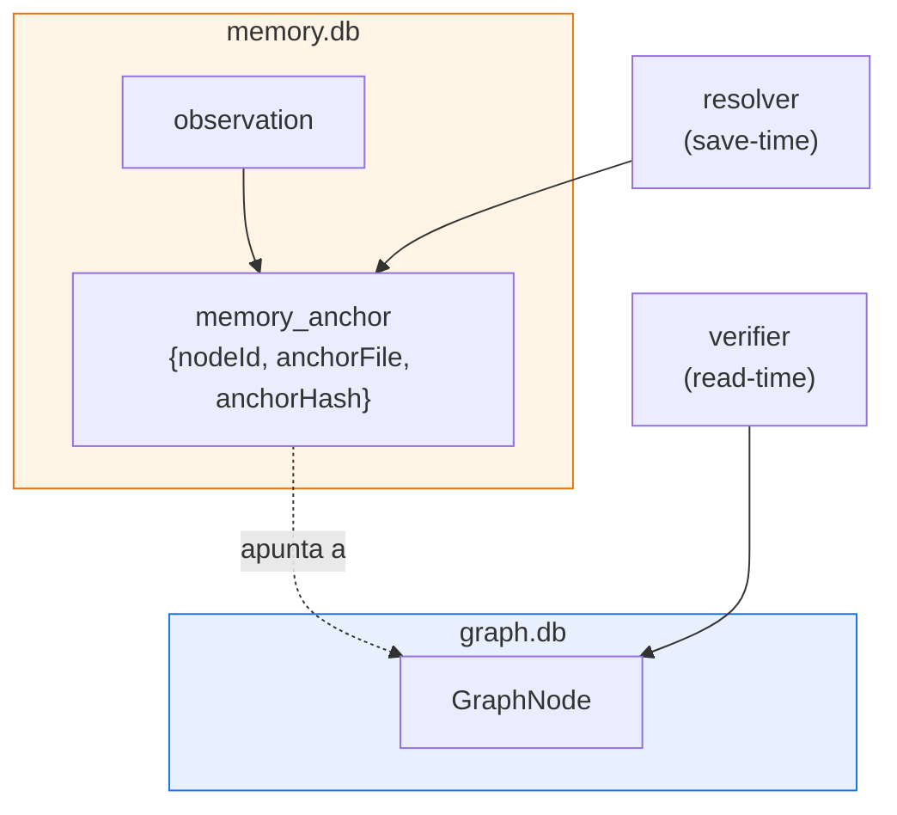
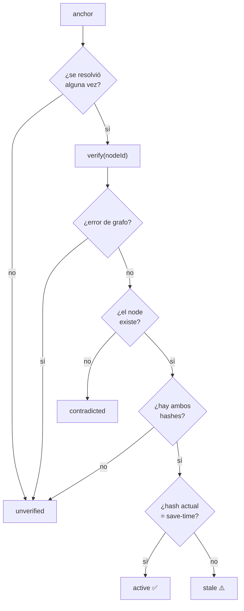
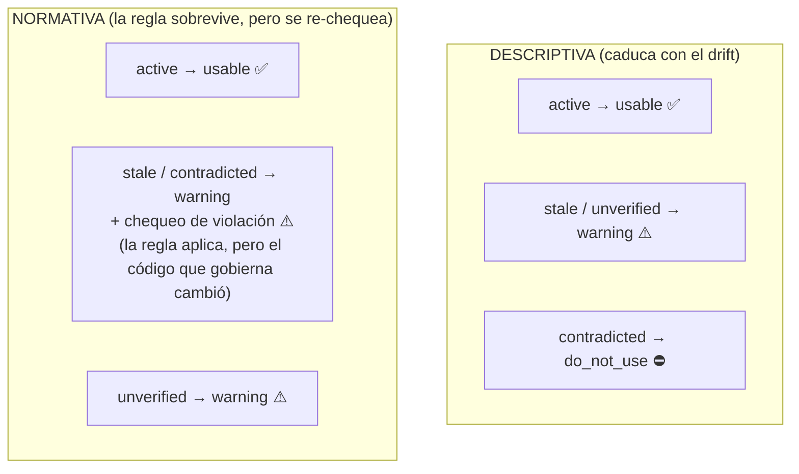
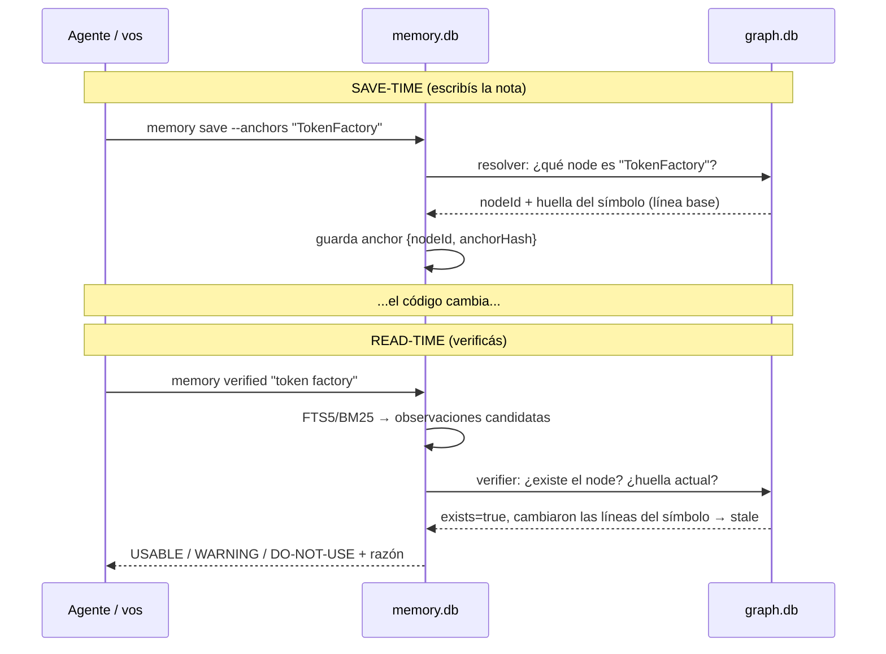

# 5. Cómo se hablan el grafo y la memoria (drift detection)

> **En una frase:** las observaciones de memoria se "clavan" a nodes del grafo con *post-its*
> (`anchors`); cuando el código cambia, leina compara el estado guardado contra el grafo
> vivo y clasifica cada nota como **USABLE**, **WARNING** o **DO-NOT-USE**.

Este es el capítulo donde el cartógrafo y el bibliotecario por fin se dan la mano.

---

## Dos bases separadas, una conversación

Recordá: el grafo (`graph.db`, por repo) y la memoria (`memory.db`, global) están
**desacoplados en disco**. La memoria nunca accede al grafo directamente. Se unen en la
**capa de aplicación**, que le pasa a la memoria dos funciones que *saben* hablar
con el grafo: un **resolver** (para clavar post-its) y un **verifier** (para revisarlos).

El grafo se abre **lazy**: solo si realmente se ejercitan anchors *y* existe un `graph.db`. Si
no hay grafo, los anchors quedan sin resolver (estado `unverified`) y nada se rompe.

---

## El post-it: cómo se clava un anchor

Pensá un anchor como una nota adhesiva pegada a una página de un libro que se reescribe. Cuando
guardás una observación con `--anchors "TokenFactory"`, en **save-time** ocurre:

1. Se busca en el grafo el/los node(s) cuyo label coincide **exacto** (functional-exact, sin
   substring difuso) con `"TokenFactory"`.
2. Para cada match se toma una **huella** del working tree:
   - una **huella de símbolo** (`sym1:<sha256>`) de las *líneas propias* del símbolo — siempre que
     el node tenga línea de inicio (`sourceLocation`) en un lenguaje con regla de span (TS/JS,
     Java, C#, Go, Rust, C/C++, Kotlin, Swift, PHP… por llaves; Python por indentación);
   - si no, el SHA-256 del **archivo entero** (nodes module/config, otros lenguajes), o el hash
     del manifest del build cuando el archivo no se puede leer.
3. Se guarda en `memory_anchors`: `nodeId`, `sourceFile` y ese `anchorHash` de save-time.

Esa huella es la foto *en el momento en que escribiste la nota*. Es la línea base contra la que
después se mide el drift. Si el label no resuelve (no hay grafo, no hay match), el anchor se
guarda igual pero sin `nodeId` → quedará `unverified`. **Fail-open:** cualquier error devuelve
`[]`, nunca rompe el save.

**Cómo se encuentran las líneas del símbolo.** El grafo solo registra dónde *empieza* un
símbolo (`"L42"`). El span se deriva del código: se busca el nombre del símbolo en esa línea (o
en la línea más cercana que lo nombre, así un grafo construido hace unas ediciones igual cae en
él) y se recorre hasta el final de su declaración — balanceando llaves y saltando strings,
comentarios y regex literales, o el bloque indentado en Python. La huella hashea esas líneas
recortadas y sin líneas en blanco: re-indentar no es drift, cambiar cualquier token sí. El span
es una heurística, pero determinista: la huella de save-time y la de read-time solo difieren
cuando cambió el texto del propio símbolo.

---

## La revisión: detectar drift en read-time

Cuando corrés `leina memory verified`, el bibliotecario revisa cada post-it
**en el momento de leer** (nunca se persiste el resultado). Para cada anchor, el verifier
pregunta al grafo: *¿este node todavía existe? ¿cuál es su huella actual en el disco?* — las
líneas del símbolo para un anchor `sym1:`, el archivo entero para uno de nivel archivo. Y a partir
de eso se decide el estado:

Los cuatro estados (`MemoryState`):

| Estado | Significa | El post-it... |
|--------|-----------|---------------|
| `active` | el node existe y **su huella no cambió** | sigue pegado y vigente |
| `stale` | el node existe pero **el símbolo cambió** (o ya no se encuentra en su archivo); en un anchor de nivel archivo, **el archivo cambió** | sigue pegado, pero la página se reescribió |
| `contradicted` | el node **ya no existe** en el grafo | la página fue arrancada |
| `unverified` | nunca resolvió a un node, o el grafo no está disponible | no sabemos contra qué página estaba |

Cuando una observación tiene **varios** anchors, el estado se agrega: gana el peor caso
(`contradicted` > `stale` > `unverified` > `active`) — con una excepción: un anchor de archivo
entero sobre un archivo del que la misma nota también fija *símbolos* (`src/cli/doctor.ts` junto
a `checkHooks`) no cuenta como `stale`. Deciden los símbolos; una edición en otra parte de ese
archivo no es drift para la nota. (Un node que desapareció sí cuenta.)

### Actualizar anchors previos a 3.0: `memory reanchor`

Antes de 3.0 cada anchor guardaba el hash del archivo entero, así que cualquier edición en
cualquier parte del archivo marcaba la nota. `leina memory reanchor <dir>` actualiza esos anchors
en el lugar a huellas de símbolo **sin mover su línea base**: el hash guardado identifica una
versión exacta del archivo — el working tree si no cambió, si no un commit encontrado recorriendo
la historia de ese archivo en cualquier ref (de más nuevo a más viejo, últimos 300 commits) — y
el símbolo se huellea *en esa versión*. Un anchor actualizado da `active` solo si el propio
símbolo no cambió desde que se guardó la nota. Los anchors cuya versión no aparece, y los de
module/config, quedan a nivel archivo. `--dry-run` informa qué cambiaría.

El mismo comando también crea anchors a partir de las referencias de código entre backticks de
cada nota (`` `openFreshStore` ``, `` `src/cli/wiring.ts` ``, `` `src/a.ts:helper` ``) cuando una
resuelve a exactamente un node. Ignora identificadores de menos de 3 caracteres y palabras
genéricas (`get`, `query`, `foo`, `npm`…), prefiere código de producción sobre tests cuando un
nombre matchea ambos, y nunca ancla un nombre suelto solo a código de test — calificalo
(`test/x.test.ts:helper`) si es eso lo que querés.

---

## El veredicto: descriptive vs normative

Acá está la sutileza más importante. No todas las notas envejecen igual:

- Una nota **descriptiva** ("este módulo cachea sesiones en memoria") describe *cómo es* el
  código. Si el código cambió, la descripción **caducó**.
- Una nota **normativa** ("NUNCA loguear el token en claro") es una *regla*. Aunque el código
  cambie, la regla **sigue valiendo** — de hecho, si el código drifteó, lo que querés es chequear
  que no se haya *violado*.

El `type` de la observación define su `nature`: tipos como `architecture`/`bugfix` son
**descriptivos**; `decision`/`preference` son **normativos**. La clasificación final
cruza `nature` × `state` para dar un `verdict`:

Una regla con drift nunca se descarta, pero tampoco se sirve como `usable` (antes de 3.0 sí):
el código que gobierna cambió, así que se le pide al agente que chequee que no se haya violado.

El **estado de ciclo de vida** de la nota (`active` / `resolved` / `obsolete`, ver
[Memoria](./04-memoria.md)) es un segundo eje, independiente: se informa al lado del `state` de
drift — nunca se mezcla con él — y pone un techo al veredicto. Una nota `resolved` es historia,
no la verdad actual, así que como mucho es `warning`; una `obsolete` siempre es `do_not_use`.

| Veredicto | Qué le dice al agente |
|-----------|------------------------|
| `usable` | confiá en esta nota |
| `warning` | usala con cuidado; puede estar desactualizada o no se pudo verificar |
| `do_not_use` | esta descripción ya no aplica; ignorala |

El contexto verificado arma la respuesta completa: busca las observaciones que matchean la query,
deriva el estado de cada una contra el grafo vivo, y las reparte en `usable` / `warning` /
`doNotUse` con su razón. Así el agente no solo recibe *qué* se anotó, sino *cuánto puede
confiar* en cada nota hoy.

---

## El ciclo completo, de punta a punta

> **Por qué read-time y no persistido:** el estado de drift se deriva al vuelo. Eso mantiene la
> memoria fresca sin re-chequeos constantes, y significa que la *misma* nota puede pasar de
> `usable` a `stale` simplemente porque el código cambió — sin tocar la base de memoria.

---

## Para seguir

- Cómo toda esta inteligencia llega al agente sin que la pida → [Hooks e inyección](./06-hooks-e-inyeccion.md)
- De dónde sale el `affected` que conviene correr antes de migrar → [Búsqueda y consultas](./03-busqueda-y-consultas.md#affected--qué-se-rompe-si-toco-esto-blast-radius)
