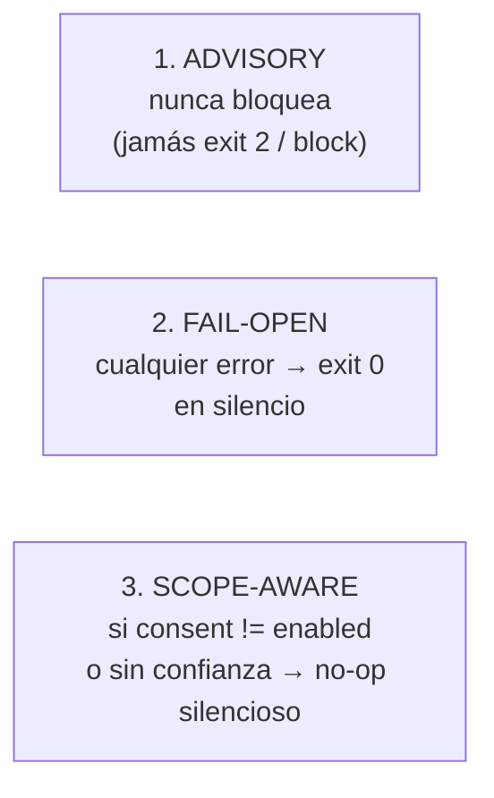
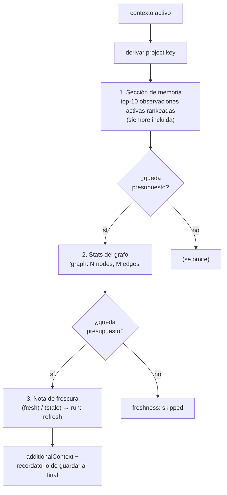
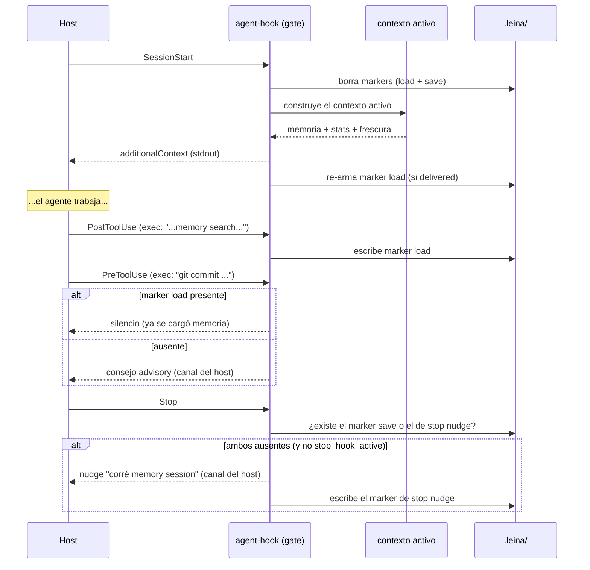

# 6. Hooks del agente e inyección de contexto

> **En una frase:** los *hooks* son el conserje del repo — al empezar la sesión te dejan en el
> escritorio las notas del bibliotecario y el estado del mapa, al terminar te recuerdan guardar,
> y mientras tanto te dan algún consejo— pero **nunca te traban la puerta**.

Sin hooks, todo leina sería opt-in: la IA tendría que acordarse de correr
`memory context` y `query`. Los hooks hacen que el contexto **llegue solo**.

---

## Qué es un hook y cuándo dispara

El host emite eventos durante una sesión, conectados a `leina agent-hook <Event>` por hooks
que se registran a nivel **user-global** (los instala `setup`/`activate` para cada host elegido —
`~/.config/devin/config.json` de Devin, `~/.claude/settings.json` de Claude Code —, disparan en
todos los repos y resuelven el root en runtime) o, en modo standalone, en los archivos de
proyecto que escribe `init` (FULL): `.devin/hooks.v1.json`, `.claude/settings.json`.

| Evento | Matcher | Qué hace el conserje |
|--------|---------|----------------------|
| `SessionStart` | (todos) | borra los markers e **inyecta** memoria + stats del grafo |
| `PostCompaction` | (todos) | re-inyecta el contexto tras una compactación |
| `UserPromptSubmit` | (todos) | en el primer turno, inyecta contexto si aún no se cargó |
| `PreToolUse` | Devin `edit\|write\|exec`, `grep\|glob`; Claude Code `Edit\|Write\|MultiEdit\|NotebookEdit\|Bash` | consejo advisory (p. ej. ante `git commit` o `grep`); en un workspace de confianza, el sello de integridad, el scope del contract y el guard de commit del harness |
| `PostToolUse` | Devin `exec`, `read\|grep\|glob`; Claude Code `Bash\|Grep\|Read\|Glob` | detecta carga/guardado de memoria; consejo único tras una búsqueda nativa |
| `Stop` | (todos) | recuerda persistir la sesión si no se guardó |

---

## Las tres garantías de oro

Antes de los flujos, estas tres invariantes explican *todo* el comportamiento:

1. **Advisory only.** El gate nunca devuelve `block`. Como mucho le da al agente un empujón de
   una sola vez, por el canal que su host realmente muestra (ver
   [el protocolo de salida](#el-protocolo-de-salida-por-host)); el agente **siempre** procede. (La rama de exigencia
   del harness que comparte el punto de entrada `agent-hook` *sí* puede bloquear, en un
   workspace de confianza — ese es el trabajo del inspector, ver [el harness](./07-harness.md).)
2. **Fail-open.** stdin vacío/inválido, campos faltantes, errores de fs, grafo no disponible →
   `exit 0` en silencio. El sistema nunca crashea al agente.
3. **Scope-aware no-op.** Un hook user-global dispara en *todos* los repos de la máquina. El gate
   solo actúa cuando el flag de consentimiento del repo es `enabled` (archivo `.leina/consent`)
   **y** el workspace es de confianza en esta máquina — el registro fuera del repo que escribe
   `leina init` bajo `$LEINA_HOME/trust/`; un flag de consentimiento commiteado no otorga nada
   (ver [confianza del workspace](./07-harness.md#confianza-del-workspace--qué-puede-correr-sin-supervisión)).
   Si no, el gate retorna en silencio: sin inyección de contexto, sin advisories, sin build del
   grafo en segundo plano. Así el hook global no molesta en repos ajenos, y el skill
   `leina-setup` pregunta una sola vez en los repos `unknown`.

---

## El protocolo de salida por host

Un empujón que nadie lee es ruido. Cada entrada gestionada dice qué host la corre
(`agent-hook <Event> --host claude|devin`; una entrada sin el flag cuenta como Claude Code si
`CLAUDE_PROJECT_DIR` está definida, y como Devin si no), y el gate responde por el canal que ese
host documenta:

| Qué | Claude Code | Devin |
|-----|-------------|-------|
| inyección de `SessionStart` / `UserPromptSubmit` | `hookSpecificOutput.additionalContext` (JSON por stdout) | igual |
| consejo de `PreToolUse` (`git commit`, `grep`) | `additionalContext`, junto al resultado de la tool | `stderr` |
| consejo de `PostToolUse` tras búsqueda nativa | `additionalContext` | `additionalContext` (documentado para `PostToolUse`) |
| empujón de guardado en `Stop` | `additionalContext` — la conversación sigue para que el agente guarde | `stderr` |
| yield del `Stop` del harness (tope de reintentos) | `systemMessage`, que ve el usuario | `stderr` |

Claude Code nunca le muestra al agente el `stderr` de un hook que sale con 0; por eso para él
nada advisory viaja por ahí. Como un empujón de `Stop` **continúa** la conversación en Claude
Code, está acotado: nunca en un stop que un Stop hook ya continuó (`stop_hook_active: true`) y
como mucho una vez por sesión.

### Una respuesta por evento

El mismo cableado puede estar en hasta cuatro archivos: los del proyecto (`.devin/hooks.v1.json`,
`.claude/settings.json`) y los user-global (`~/.config/devin/config.json`,
`~/.claude/settings.json`). Un host dispara cada copia que carga — Claude Code sus dos, Devin sus
dos **y** las dos de Claude Code. Para que una sola tool call no corra el conserje dos veces,
cada copia se fija, para el evento en curso, si una copia de mayor prioridad que el host también
carga lo cablea, y en ese caso se hace a un lado en silencio:

| Host que corre | Prioridad (mayor primero) |
|----------------|---------------------------|
| Claude Code | `.claude/settings.json` del proyecto → `~/.claude/settings.json` |
| Devin | `.devin/hooks.v1.json` del proyecto → `.claude/settings.json` del proyecto → `~/.config/devin/config.json` → `~/.claude/settings.json` |

La verificación es por evento: un archivo de proyecto de una versión anterior al que le falta un
evento deja que la copia user-global lo atienda. Las entradas escritas antes de que existiera el
flag `--host` no saben qué copia son y corren siempre.

---

## ¿En qué proyecto estoy? (resolución del root)

Un hook user-global no está fijado a un directorio. ¿Cómo sabe sobre qué repo opera?
Lee la variable "project dir" que documenta el host — `CLAUDE_PROJECT_DIR` (Claude Code) o
`DEVIN_PROJECT_DIR` (Devin), el mismo contrato bajo otro nombre, gana la primera no vacía— y cae
al directorio actual si ninguna está seteada.

Ese directorio puede ser un subdirectorio del proyecto o un worktree suyo (Claude Code pone los
suyos bajo `.claude/worktrees/<nombre>`), así que el hook sube desde ahí:

- **root del proyecto** — el ancestro más cercano con un flag `.leina/consent` (un flag
  `disabled` más cercano le gana a un padre habilitado); un worktree enlazado en otro lugar se
  mapea a su worktree principal, porque `.leina/` está en el gitignore y nunca viaja con un
  checkout. El scope guard, los markers y la inyección se anclan acá.
- **root del harness** — el ancestro más cercano con `.harness/` o `.git`: el checkout que
  realmente se edita, con sus propias reglas. Hereda la confianza del root del proyecto solo
  dentro del **mismo repositorio** (el repo, un subdirectorio o uno de sus worktrees); un clon
  independiente anidado o un submódulo necesita su propia confianza (`leina init` ahí).

---

## Inyección activa: qué se le pone en el escritorio

El corazón es la construcción del **contexto activo**. Arma un bloque de
`additionalContext` con tres partes, bajo un **presupuesto de 2500ms** que degrada con gracia:

- **Memoria:** las 10 observaciones **activas** más relevantes del proyecto — rankeadas por
  peso de tipo × recencia, como mucho dos por familia de topic (la misma vista que
  `leina memory context`; ver la referencia del CLI) — cada una como
  `- [type] título (#idcorto · fecha · topic)` más hasta tres líneas de preview, después de un
  encabezado `N of M active notes` y el resumen de la última sesión, y seguidas de los verbos
  `memory get` / `memory resolve` (que aceptan el id corto). Las notas resueltas/obsoletas nunca
  se inyectan. La sección queda por debajo de ~6000 chars (≈1.2–1.6k tokens). Si no hay
  observaciones aún, inyecta `## Project memory\n(no observations yet)`.
- **Grafo:** el conteo `N nodes, M edges` leído del `graph.db`.
- **Frescura:** corre el chequeo de frescura y agrega `(fresh)` o `(stale)` con la
  sugerencia de `refresh` (o `build` si no hay grafo todavía).

Si todo falla, cae a un texto estático que le recuerda al agente correr
`memory context` y preferir `query`/`affected` sobre grep. La construcción devuelve además un
flag `delivered` que el gate usa para decidir si re-armar el marker de carga.

---

## Los markers: el estado por-sesión

El conserje lleva unas pocas banderitas en `<cwd>/.leina/`, que se **borran cuando empieza una
sesión nueva** (semántica por-sesión) y se vuelven a poner cuando corresponde. Una sesión nueva es
un `SessionStart` con `source` `startup` o `clear` — o sin `source` (Devin). Claude Code también
dispara `SessionStart` en `resume` y `compact`: esos inyectan contexto pero conservan los
markers, porque la conversación (y lo que ya cargó, guardó y se le dijo) sigue.

| Marker | Archivo | Quién lo escribe | Para qué |
|--------|---------|------------------|----------|
| **load** | `session.memory-loaded` | `PostToolUse` cuando un `exec` corre `memory (context\|search\|verified)`; o la inyección exitosa | corta en seco los consejos una vez que la memoria ya se cargó |
| **save** | `session.memory-saved` | `PostToolUse` cuando un `exec` corre `memory (save\|session\|update)` | lo lee `Stop` para decidir si recordar guardar |
| **stop nudge** | `session.stop-nudge-shown` | `Stop` después de empujar | deja el empujón de guardado en una vez por sesión |
| **search tip** | `session.native-search-nudge-shown` | `PostToolUse` después del consejo de búsqueda nativa | deja ese consejo en una vez por sesión |
| **fallback** | `session.context-fallback-shown` | toda inyección que cayó al texto estático | evita que `UserPromptSubmit` repita ese texto en cada prompt |

El marker de save excluye el propio arranque de sesión (`session-start`): abrir una sesión no
cuenta como "ya guardaste".

---

## Un turno completo, de SessionStart a Stop

Detalles por evento:

- **SessionStart**: en una sesión nueva (`startup`/`clear`/sin `source`) borra los markers;
  siempre inyecta contexto; re-arma el marker load si la entrega fue exitosa.
- **PostCompaction**: re-inyecta igual que SessionStart pero **sin** resetear los markers (el
  campo `summary` se ignora a propósito; la re-inyección es incondicional).
- **UserPromptSubmit**: si el marker load ya existe → silencio total (la inyección ya pasó). Si
  no, inyecta por `stdout` y escribe el marker. Cuando la inyección solo puede dar el texto
  estático de respaldo, ese texto sale una vez por sesión (el marker fallback), no en cada
  prompt. Sin advisory por stderr (la inyección lo reemplaza).
- **PreToolUse**: con `git commit` emite un consejo de cargar memoria; con `grep`/`rg`/`find`
  emite un consejo de usar `leina query`/`affected`. Si el marker load existe, calla.
- **PostToolUse**: escribe el marker load o save según el comando `exec`. Nunca reconstruye
  el grafo: las lecturas refrescan un grafo stale de forma perezosa (ver
  [Búsqueda y consultas](./03-busqueda-y-consultas.md#el-freshness-gate)). Los archivos de
  proyecto de Devin escritos antes de 3.0 corrían `leina refresh` en cada `edit`/`write`; volver
  a correr `init` o `repair` elimina esa entrada.
- **Stop**: si falta el marker save, emite el empujón de guardado una vez por sesión (nunca con
  `stop_hook_active` en true), por el canal del host. Nunca bloquea (exit 0 en todas las ramas).

---

## doctor: ¿está listo para inyectar?

`leina doctor` chequea la *injection-readiness*: que existan la memoria global y el
`graph.db`, para detectar un estado degradado donde la inyección
activa funcionaría a medias — y que algo dispare: consent habilitado, workspace de confianza y
hooks cableados para al menos un host. Su grupo **hooks** dice, por archivo de hooks, si cada
entrada gestionada lanza la instalación que estás corriendo (una reinstalación o un cambio de
version manager las puede dejar apuntando a otra o a nada — `leina repair` las reescribe), y
avisa cuando un host elegido no tiene hooks en ningún lugar que carga. Una invariante clave: **doctor nunca abre SQLite** — todos los
chequeos son solo de filesystem (stat, leer texto/JSON). Eso evita efectos colaterales (WAL/SHM)
y lo mantiene rápido y seguro. Su chequeo **workspace trust** dice si el gate puede actuar acá
siquiera: un warning cuando el consent es `enabled` pero esta máquina no tiene el registro de
confianza (volvé a correr `leina init <root>`).

---

## Cierre del recorrido

Con esto cerramos el círculo de la analogía:

- el **cartógrafo** levanta el mapa ([grafo](./02-grafo.md)) y lo mantiene fresco
  ([búsqueda](./03-busqueda-y-consultas.md));
- el **bibliotecario** lleva el diario ([memoria](./04-memoria.md)) y sabe qué notas
  envejecieron ([drift](./05-comunicacion-grafo-memoria.md));
- el **conserje** (este capítulo) hace que todo eso llegue al agente en el momento justo, sin
  trabarle nunca la puerta.

Volvé al [índice](./README.md) para releer cualquier pieza.
