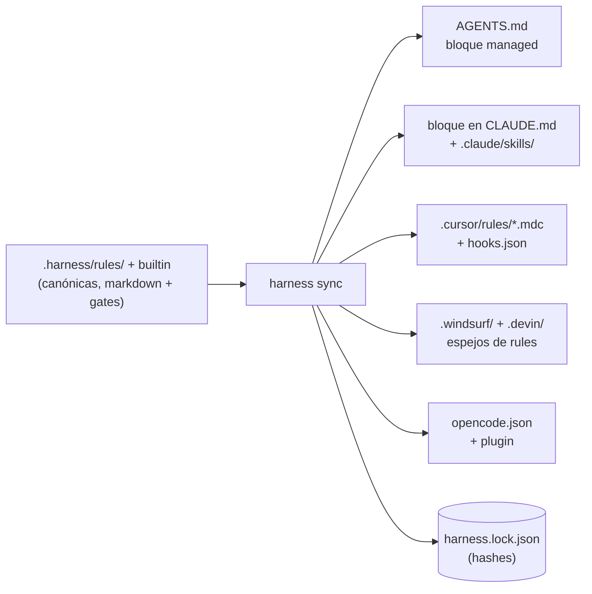

# El harness — reglas con gates ejecutables

> **El empleado:** el **inspector de obra**. El cartógrafo sabe qué ES el código, el
> bibliotecario sabe POR QUÉ llegó a ser así — el inspector se asegura de que un trabajo se
> **declare antes de empezar y se verifique antes de darlo por terminado**. A diferencia del
> conserje (los hooks, que solo dejan notas), el inspector puede negarse a firmar.

---

## Por qué un harness

Las instrucciones a un agente ("corré los tests", "quedate dentro del scope", "no commitees
secretos") son texto — el modelo puede ignorarlas, olvidarlas o racionalizar para esquivarlas.
El harness convierte cada una de esas instrucciones en dos mitades acopladas:

- un **cuerpo markdown** que el modelo lee (el *por qué* y el *cómo*), y
- un **gate** opcional que la máquina ejecuta (la *prueba*).

"Los tests tienen que pasar" deja de ser prosa y se convierte en `npm test` saliendo con 0,
chequeado por un proceso con el que el modelo no puede discutir. Ese es todo el diseño en una
frase: **consejo para el modelo, evidencia para la máquina.**

## El modelo

### Rules

Una rule es un archivo markdown con frontmatter JSON, resuelto desde tres capas:

| capa | dónde | le gana a |
|---|---|---|
| `builtin` | viene con leina (`assets/harness/rules/`) | — |
| `project` | `<repo>/.harness/rules/` | builtin |
| `user` | `~/.leina/harness/rules/` | project — **excepto para debilitar** |

Cada rule declara un `id` (`namespace/slug`), una `phase` del ciclo de vida
(`intake → plan → execute → verify → deliver`), una `severity` (`blocking` | `advisory`),
un `scope` opcional (`paths`, `taskTypes`, `languages`) y cero o más gates.

**La invariante de exigibilidad:** una capa user-local puede *reemplazar* una rule de
proyecto, pero nunca puede **deshabilitar** una rule blocking ni **degradarla** a advisory.
El intento se ignora con un warning. Unos guardarraíles que cualquier capa pudiera apagar no
serían guardarraíles.

### Gates

Seis tipos de gate ejecutables, corridos por un engine con un pool paralelo acotado, timeouts
por gate y semántica **fail-closed** (`fail`, `error` y `timeout` cuentan todos como falla
blocking cuando la rule es blocking):

| gate | prueba |
|---|---|
| `command` | un comando de shell sale con el código esperado (y el stdout matchea, opcionalmente) |
| `file` | un archivo existe / matchea / tiene un tamaño mínimo (p. ej. `plan.md` antes de codear) |
| `diff` | el diff de git se mantiene dentro del scope declarado en el contract |
| `diff-content` | ninguna línea **agregada** matchea un patrón prohibido (secretos, `.only`/`.skip`) — incluso en archivos aún sin `git add` |
| `checklist` | cada criterio de aceptación está tildado |
| `js` | cualquier otra cosa — un módulo local del repo devuelve `{ pass, message }` |

Los globs `onlyIfChanged` permiten que un gate se saltee a sí mismo cuando nada relevante
cambió, lo que mantiene `verify` rápido en tareas solo-docs.

### El contract

La pieza que invierte la carga de la prueba. Antes de una tarea no trivial, el agente (o
vos) declara:

```bash
leina harness contract new --goal "Add the export endpoint" --type feature \
  --scope "src/routes/**" --scope "test/**" \
  --criterion "endpoint covered by a failing-first test"
```

El contract registra el HEAD de git al momento de la declaración (`baseRef`). Desde ahí, la
**propia declaración del agente es la frontera objetiva**: el gate `diff` falla ante
cualquier archivo fuera del scope declarado, y ampliar el scope exige un
`contract edit --add-scope` explícito — visible, auditable, nunca silencioso. Cerrar la
tarea (`contract end`) archiva todo el estado en `.harness/state/history/`.

La declaración ocurre *antes* del trabajo, cuando no hay incentivo para hacer trampa; la
verificación ocurre *después*, cuando no hay manera de hacerla.

### Recipes

Procedimientos de camino dorado (`add-endpoint`, `fix-bug`) — listas de pasos parametrizadas
que empiezan con un contract y terminan con `verify` + `contract end`. Solo sus gates
terminales son exigibles; su valor es la reducción de varianza: el agente sigue una secuencia
conocida y probada en vez de improvisar una.

## El muro de completitud

`leina harness verify` es el oráculo único, con un contrato de exit codes que todos los
transportes comparten:

- `0` — todos los gates blocking pasaron; la tarea puede darse por completa;
- `1` — falla blocking; el reporte dice exactamente qué y por qué;
- `2` — el harness mismo está mal configurado (rule inválida, config rota).

En hosts con hooks, el **stop hook** corre verify cuando el agente intenta terminar su turno:
las fallas vuelven como la siguiente instrucción del agente (block), hasta `maxRetries` veces
— y entonces **cede honestamente**: "allowing stop so a human can look", nunca un verde
falso. El hook pre-bash rechaza `git commit` / `git push` mientras haya gates blocking
fallando, y el hook pre-edit mantiene al agente dentro del scope del contract.

**Frontera de integridad — y el modelo de amenaza, dicho con honestidad:**
`.harness/rules/`, `.harness/config.json` y el lockfile son de solo lectura para el agente:
el hook pre-edit sella el camino de las tools Edit/Write en *todos* los modos de strictness,
y el hook pre-bash bloquea las formas de escritura comunes por shell (redirecciones,
`sed -i`, `rm`, `tee`, …) contra esas rutas. El estado de la tarea (`.harness/state/` —
plan, checklist, contract) sigue siendo escribible por el agente: esa es la superficie que
el flujo de trabajo necesita.

Seamos claros sobre qué es esto: el harness es un **guardarraíl contra accidentes y
deriva, no un sandbox contra un agente adversario**. Un modelo decidido a hacer trampa
todavía puede llegar a los archivos por canales que ningún hook puede parsear del todo
(expansión de variables, quoting exótico, un script que él mismo escribe y ejecuta). Las
garantías que **no** dependen de la cooperación del agente son las ancladas fuera de la
conversación: el exit code de `verify`, los hashes del lockfile y `sync --check` en CI.
Si necesitás aislamiento duro, corré el agente en un sandbox — el harness seguirá siendo
lo que te dice *si el trabajo está terminado*, cosa que ningún sandbox hace.

## Un solo set de rules, muchos hosts

`leina harness sync` compila las rules canónicas a lo que cada plataforma puede exigir:



Tres propiedades hacen que esto sea seguro de re-correr para siempre:

1. **Targeting basado en evidencia.** Una plataforma solo se escribe cuando la config o los
   flags la nombran, o el repo ya trae sus archivos. leina nunca elige un host de IA por vos.
2. **Bloques managed + lockfile.** El harness co-posee archivos como `CLAUDE.md` mediante
   bloques marcados; todo lo que queda fuera de los marcadores no se toca jamás. El hash de
   cada artifact vive en `.harness/harness.lock.json` — un artifact editado a mano entra en
   **conflicto** (se conserva intacto, se reporta) en vez de ser pisado; `--force` es el
   override explícito.
3. **Remoción simétrica.** `leina deinit` recorre el mismo lockfile en reversa: los archivos
   propios se borran solo si no fueron tocados, los bloques se quitan solo si su interior no
   fue tocado, y las entradas del harness se eliminan de los JSON compartidos (las entradas
   del usuario sobreviven textuales).

La exigencia difiere por host — Claude Code y OpenCode reciben hooks blocking, Cursor recibe
hooks advisory más un guard de commit, los hosts solo-AGENTS.md reciben instrucciones — pero
el **oráculo es idéntico en todas partes**: pueda o no exigirlo el host,
`leina harness verify` sale con 0 o no sale con 0.

## Dónde vive cada cosa

```
.harness/
├── config.json          # platforms, strictness (guided|strict), overrides de rules
├── rules/               # rules de proyecto (overridean las builtin por id)
├── harness.lock.json    # hashes de artifacts — el libro contable de paridad del sync
├── generated/           # archivos de host que el harness posee por completo (p. ej. rules de opencode)
└── state/               # estado de tarea git-ignored
    ├── current/         #   contract.json · checklist.md · plan.md · verify-report.json · retries.json
    └── history/<ts>/    #   contracts archivados, un dir por tarea terminada
```

Las rules builtin específicas de leina (`leina-memory-first`, `leina-graph-consult`,
`leina-graph-fresh`, `leina-session-summary`) cierran el círculo con los otros dos
empleados: el inspector exige que el agente consulte al bibliotecario antes de empezar,
mantenga fresco el mapa del cartógrafo y deje la entrada en la bitácora antes de firmar.

## Presets de rules — `generic` vs `leina-native`

Esas cuatro rules acopladas a leina son **blocking por defecto**, y solo pasan cuando
leina mismo está adoptado en el repo (grafo construido, memoria en uso). Un equipo que
quiere el harness por su valor *genérico* — tests-pass, no-secrets, diff-in-scope,
lint-clean — no debería heredar cuatro rules que fallan salvo que además corra comandos
leina. De ahí los dos presets (definidos en `application/harness/recipes.ts`):

| preset | qué gobierna | `.harness/config.json` |
|---|---|---|
| `leina-native` | la suite builtin completa, **incluyendo** las cuatro rules `leina-*` — el default histórico | `{}` (la misma semilla prístina que escribe `leina init`) |
| `generic` | solo las rules agnósticas del host (`tests-pass`, `no-secrets`, `diff-in-scope`, `lint-clean`, `typecheck`, `no-skipped-tests`, `plan-before-code`, `criteria-checklist`, `contract-interview`, `changelog-updated`) — **ninguna rule exige un comando leina** | la config de abajo |

Un preset nunca edita los archivos de rules — se realiza por completo mediante overrides
de config (la capa de proyecto puede deshabilitar rules builtin; solo las capas
*user-local* tienen prohibido debilitar, ver la invariante de exigibilidad). El preset
`generic` es exactamente:

```json
{
  "rules": {
    "harness/leina-graph-consult": { "enabled": false },
    "harness/leina-graph-fresh": { "enabled": false },
    "harness/leina-memory-first": { "enabled": false },
    "harness/leina-session-summary": { "enabled": false }
  }
}
```

`presetConfig("generic")` en `application/harness/recipes.ts` genera este archivo —
deriva la lista `leina-*` escaneando las rules builtin al momento de la llamada, así que
una nueva rule acoplada a leina se suma automáticamente a la lista de exclusión del
preset. Para adoptar el preset `generic` hoy, escribí ese JSON como tu
`.harness/config.json`; mantené (o volvé a) `{}` para `leina-native`.

## Mapa de vocabulario — dos vocabularios de hooks, un cerebro, tres "gates"

El harness llegó desde un framework de origen, y parte de su vocabulario aterrizó
duplicado o sobrecargado. Esta sección es la tabla de desambiguación.

### Dos vocabularios de eventos de hook para el mismo ciclo de vida

Hay dos vocabularios de eventos porque hay dos **transportes**, no dos engines:

- `leina agent-hook <Event>` — el **agent gate** neutral al host (capítulo 6), que habla
  la forma de eventos de `.devin/hooks.v1.json` (`SessionStart`, `UserPromptSubmit`,
  `PreToolUse`, `PostToolUse`, `PostCompaction`, `Stop`). Lo instala `leina init` para
  Claude Code y Devin/Windsurf.
- `leina harness hook <event>` — el CLI de hooks propio del harness, con sus propios
  nombres de eventos (`session-start`, `pre-edit`, `pre-bash`, `stop`, `cursor-*`,
  `idle`). Lo cablea `harness sync` para Cursor y OpenCode.

Ambos convergen en las **mismas funciones de decisión** de
`application/harness/hooks.ts` — los vocabularios difieren, el cerebro no:

| momento del ciclo | evento del agent-gate (`leina agent-hook`) | evento del harness hook (`leina harness hook`) | decisión compartida |
|---|---|---|---|
| abre la sesión | `SessionStart` | `session-start` | inyectar estado del contract + rules de intake |
| antes de editar un archivo | `PreToolUse` (tool `Edit`/`Write`/`MultiEdit`/`NotebookEdit`, o `edit`/`write` en Devin) | `pre-edit` | `decidePreEdit` — scope del contract + frontera de integridad |
| antes de un comando de shell | `PreToolUse` (tool `Bash`, o `exec` en Devin) | `pre-bash` | `decidePreBash` — guard de commit/push + frontera de integridad |
| el agente intenta terminar su turno | `Stop` | `stop` | `decideStop` — corre verify; bloquea, o cede tras `maxRetries` |
| después de correr una tool | `PostToolUse` (markers advisory) | `cursor-after-edit` (registro de ediciones) | — |
| momentos solo-advisory | `UserPromptSubmit` / `PostCompaction` (inyección de contexto) | `cursor-stop` / `idle` | `advisoryVerifyFeedback` |
| permiso de shell en Cursor | — | `cursor-shell` | `decideCursorShell` |

### Por qué la exigencia está bifurcada por host

- **Claude Code y Devin/Windsurf** ya corren el agent gate que instala `leina init`.
  `harness sync` por eso les envía solo **texto** de rules (el bloque managed de
  `CLAUDE.md` + skills; espejos de rules en `.devin/` + `.windsurf/`) — la exigencia
  viaja por el gate que ya está instalado. El gate bloquea **solo mientras hay un
  contract activo** (y el consentimiento de leina no está deshabilitado); sin contract se
  queda puramente advisory.
- **Cursor y OpenCode** no tienen agent gate, así que `harness sync` escribe el cableado
  de hooks que llama a `leina harness hook <event>` directamente. El plugin generado de
  OpenCode convierte un exit distinto de cero en un bloqueo duro; Cursor recibe hooks
  advisory más un guard de permiso de shell.

Un cerebro, dos puertas: dispare el transporte que dispare, la decisión sale de las
mismas funciones, así que los hosts no pueden divergir en comportamiento.

### La palabra "gate" significa tres cosas distintas

| nombre a preferir | qué es | dónde vive | ¿puede negarse? |
|---|---|---|---|
| **verify gates** (gates de rules) | las pruebas ejecutables (`command`, `file`, `diff`, `diff-content`, `checklist`, `js`) que corre `leina harness verify` — el muro de completitud | frontmatter de las rules + `application/harness/gates/` | sí — exit 1 bloquea la completitud |
| **agent gate** (puente de hooks) | el punto de entrada de hooks del host `leina agent-hook`: inyecta contexto y traslada al host las decisiones del harness de arriba | `cli/agent-gate.ts` | solo mientras hay un contract activo; si no, advisory |
| **freshness gate** (grafo) | el chequeo de staleness que corre el *grafo* antes de responder una lectura — auto-rebuild o rechazo (capítulo 3); no tiene relación con el harness | ruta de lectura del grafo | rechaza *lecturas* del grafo, nunca tareas |

En la prosa del harness, un "gate" a secas debería significar un **verify gate**;
calificá los otros dos.
