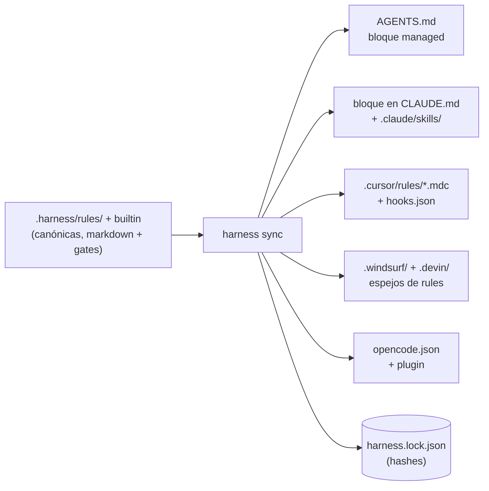

# El harness — reglas con gates ejecutables

> **El empleado:** el **inspector de obra**. El cartógrafo sabe qué ES el código, el
> bibliotecario sabe POR QUÉ llegó a ser así — el inspector se asegura de que un trabajo se
> **declare antes de empezar y se verifique antes de darlo por terminado**. A diferencia del
> conserje (los hooks, que solo dejan notas), el inspector puede negarse a firmar.

---

## Por qué un harness

Las instrucciones a un agente ("corré los tests", "quedate dentro del scope", "no commitees
secretos") son texto — el modelo puede ignorarlas, olvidarlas o racionalizar para esquivarlas.
El harness convierte cada una de esas instrucciones en dos mitades acopladas:

- un **cuerpo markdown** que el modelo lee (el *por qué* y el *cómo*), y
- un **gate** opcional que la máquina ejecuta (la *prueba*).

"Los tests tienen que pasar" deja de ser prosa y se convierte en `npm test` saliendo con 0,
chequeado por un proceso con el que el modelo no puede discutir. Ese es todo el diseño en una
frase: **consejo para el modelo, evidencia para la máquina.**

### Cómo se activa

El harness es **opt-in**. `leina init --harness` siembra `.harness/config.json` y corre el
sync (`--harness-preset generic|leina-native` implica `--harness`); un `leina init` sin el
flag no toca `.harness/`. Un repo que ya tiene `.harness/config.json` — sembrado antes,
escrito por `leina tui` o commiteado por alguien del equipo — se sigue sincronizando en cada
`init`. Los comandos `leina harness ...` funcionan en cualquier repo igual. Con o sin
semilla, un workspace de confianza siempre recibe el sello de integridad sobre las
rules/config de `.harness/` (ver más abajo).

## El modelo

### Rules

Una rule es un archivo markdown con frontmatter JSON, resuelto desde tres capas:

| capa | dónde | le gana a |
|---|---|---|
| `builtin` | viene con leina (`assets/harness/rules/`) | — |
| `project` | `<repo>/.harness/rules/` | builtin |
| `user` | `~/.leina/harness/rules/` | project — **excepto para debilitar** |

Cada rule declara un `id` (`namespace/slug`), una `phase` del ciclo de vida
(`intake → plan → execute → verify → deliver`), una `severity` (`blocking` | `advisory`),
un `scope` opcional (`paths`, `taskTypes`, `languages`) y cero o más gates.

Los gates se declaran solo en archivos de rules. Las capas de config
(`~/.leina/harness/config.json` < `.harness/config.json` < `.harness/config.local.json`)
ajustan una rule con entradas `rules.<id>` que aceptan solo `enabled` y `severity`; una
clave `gate` ahí es un error de validación — verify sale con 2 y los hooks fallan cerrados
hasta que se corrija.

**La invariante de exigibilidad:** la *línea base* es lo que exigen las capas compartidas —
el archivo de rule builtin o de proyecto más el `.harness/config.json` del proyecto. Las
capas personales (archivos de rules de usuario, campos de la config de usuario que el
proyecto no vuelve a fijar, `config.local.json`) pueden *reemplazar* o ajustar una rule,
pero frente a una línea base blocking y habilitada nunca pueden **deshabilitarla**,
**degradarla** a advisory ni cambiarle el gate, la phase o el scope. El intento se ignora y
se reporta como warning. Del mismo modo, `strictness` sale del proyecto (o del default
`guided`), y las capas personales solo pueden subirla a `strict`. Unos guardarraíles que
cualquier capa pudiera apagar no serían guardarraíles.

### Gates

Seis tipos de gate ejecutables, corridos por un engine con un pool paralelo acotado, timeouts
por gate y semántica **fail-closed** (`fail`, `error` y `timeout` cuentan todos como falla
blocking cuando la rule es blocking):

| gate | prueba |
|---|---|
| `command` | un comando de shell sale con el código esperado (y el stdout matchea, opcionalmente) |
| `file` | un archivo existe / matchea / tiene un tamaño mínimo (p. ej. `plan.md` antes de codear) |
| `diff` | el diff de git se mantiene dentro del scope declarado en el contract |
| `diff-content` | ninguna línea **agregada** matchea un patrón prohibido (secretos, `.only`/`.skip`) — incluso en archivos aún sin `git add` |
| `checklist` | cada criterio de aceptación está tildado |
| `js` | cualquier otra cosa — un módulo local del repo devuelve `{ pass, message }` |

Los globs `onlyIfChanged` permiten que un gate se saltee a sí mismo cuando nada relevante
cambió, lo que mantiene `verify` rápido en tareas solo-docs.

El módulo de un gate `js` se resuelve según la rule que lo declara: las rules builtin y de
usuario lo cargan solo desde la carpeta de su propio archivo de rule; las rules de proyecto
lo buscan primero relativo al repo y después junto al archivo de rule — los paths absolutos
se rechazan y el path real (con symlinks resueltos) tiene que quedar dentro del repo. Las
regex que aportan las rules tienen tiempo acotado: el `contentMatch` / `contentNotMatch`
del gate `file`, igual que el `forbidAdded` de `diff-content` y el `expectStdoutMatch` de
`command`, corren bajo el timeout del gate con un tope de 5 s, y agotarlo es un `error`.

### El contract

La pieza que invierte la carga de la prueba. Antes de una tarea no trivial, el agente (o
vos) declara:

```bash
leina harness contract new --goal "Add the export endpoint" --type feature \
  --scope "src/routes/**" --scope "test/**" \
  --criterion "endpoint covered by a failing-first test"
```

El contract registra el HEAD de git al momento de la declaración (`baseRef`). Desde ahí, la
**propia declaración del agente es la frontera objetiva**: el gate `diff` falla ante
cualquier archivo fuera del scope declarado, y ampliar el scope exige un
`contract edit --add-scope` explícito — visible, auditable, nunca silencioso. Cerrar la
tarea (`contract end`) archiva todo el estado en `.harness/state/history/`.

La declaración ocurre *antes* del trabajo, cuando no hay incentivo para hacer trampa; la
verificación ocurre *después*, cuando no hay manera de hacerla.

### Recipes

Procedimientos de camino dorado (`add-endpoint`, `fix-bug`) — listas de pasos parametrizadas
que empiezan con un contract y terminan con `verify` + `contract end`. Solo sus gates
terminales son exigibles; su valor es la reducción de varianza: el agente sigue una secuencia
conocida y probada en vez de improvisar una.

## El muro de completitud

`leina harness verify` es el oráculo único, con un contrato de exit codes que todos los
transportes comparten:

- `0` — todos los gates blocking pasaron; la tarea puede darse por completa;
- `1` — falla blocking; el reporte dice exactamente qué y por qué;
- `2` — el harness mismo está mal configurado (rule inválida, config rota), o la llamada
  está mal formada (un id de `--rule` desconocido, un flag sin su valor, un subcomando
  desconocido).

Solo una corrida **completa** — sin `--rule`, con phases que cubran `verify` y `deliver` —
habla por la tarea: es la única que escribe `.harness/state/current/verify-report.json`, el
reporte que lee el guard de commit. Una corrida filtrada imprime una nota por stderr y no
queda registrada, así que `verify --rule <algo en verde>` nunca puede destrabar un commit.
Una rule conocida que no aplica a la corrida es un warning, y `--json` incluye
`loadErrors`, así que un error de config nunca se lee como un reporte verde vacío.

Los archivos cambiados salen de `git diff --relative` contra el `baseRef` del contract (o
el merge-base con la rama por defecto), relativos a la raíz del harness: en un paquete de
monorepo con su propio `.harness/`, los paths son relativos al paquete y los cambios fuera
de él se ignoran. Fuera de un repositorio git (o si git no está disponible) el conjunto de
cambios es *desconocido*, no vacío, y verify **falla cerrado** con un warning: los gates
`onlyIfChanged` corren en vez de saltearse, no se aplica el scoping por paths/lenguajes, y
los gates blocking `diff-content` — y los `diff` que tienen un scope que chequear —
reportan un error. Un directorio sin git tiene que deshabilitar `harness/no-secrets` para
quedar en verde.

En hosts con hooks, el **stop hook** juzga el árbol actual cada vez que el agente intenta
terminar su turno. **Reutiliza el último verify completo** cuando ese reporte sigue
valiendo de forma demostrable — mismo `HEAD`, misma huella `worktree`, y las mismas rules,
config, contract y confianza del workspace (un digest que se guarda con el reporte) — y si
no, corre un verify fresco. Así, un turno que no cambió nada desde el último verify no
vuelve a pagar toda la suite, mientras que cualquier edición, commit, cambio de contract o
de rules la vuelve a correr. Una corrida filtrada nunca queda registrada, así que nunca se
reutiliza. Si pasa, permite el stop; si falla, la falla vuelve como la siguiente
instrucción del agente (block) — una falla reutilizada lo dice, y remite a
`leina harness verify` para arreglos hechos fuera del árbol trackeado (dependencias,
archivos ignorados por git, el grafo o la memoria de leina), que la huella no ve.
`maxRetries` (1–10, default 3; `contract new` rechaza cualquier otro valor, tanto por CLI
como por MCP) acota los bloqueos de una **cadena de stop** — desde el primer intento de
terminar el turno hasta que se permite un stop; una falla reutilizada cuenta igual que una
fresca. Al llegar al tope el hook **cede honestamente**, nombrando las rules que fallaron
para este mismo árbol: "allowing stop so a human can look", nunca un verde falso. Un pass
o una cesión reinician la cuenta, y también una cadena nueva (`stop_hook_active: false`, o
un `UserPromptSubmit`); si el contador no se puede guardar, el stop cede en vez de entrar
en un loop sin límite.

El hook pre-bash rechaza `git commit` / `git push` mientras el reporte registrado muestre
fallas blocking — o, en modo strict, mientras no haya un reporte fresco — y el hook
pre-edit mantiene al agente dentro del scope del contract. La frescura se basa en el
contenido: verify registra una huella `worktree` — el conjunto de archivos cambiados
contra la base que usó, más una identidad por archivo (sha256 del contenido; tamaño + mtime
pasados los topes de hashing de 8 MiB por archivo y 64 MiB en total; identidades para los
primeros 2000 archivos, la lista completa de paths siempre se compara; `.harness/state/` y
`.leina/` quedan excluidos) — y el guard la recalcula. Un `git status` de solo lectura
mantiene fresco el reporte; cualquier cambio de contenido lo vuelve stale, y un reporte sin
huella (de un leina anterior) cuenta siempre como stale. Cuando la config no se puede leer,
ambos hooks **fallan cerrados**: las ediciones fuera de `.harness/state/` y el commit/push
se bloquean nombrando el error de config.

**Frontera de integridad — y el modelo de amenaza, dicho con honestidad:** lo que define
los gates es de solo lectura para el agente — `.harness/rules/`, `.harness/config.json`,
`.harness/config.local.json` y el lockfile, más, fuera del repo, la capa de usuario
`$LEINA_HOME/harness/**` y el trust store `$LEINA_HOME/trust/**` (chequeados por path, con
symlinks resueltos). El hook pre-edit sella el camino de las tools Edit/Write en *todos*
los modos de strictness. El hook pre-bash lee cada comando simple (partido en `;`, `&&`,
`||`, `|`, `&`, `(`, `)` y backticks, siguiendo `cd`, `sh -c` y `eval`) y lo bloquea solo
cuando un path que **escribe** está protegido — cualquier cosa bajo `.harness/` salvo
`state/`, o el harness de usuario / trust store escritos como `~/.leina/…` o
`$LEINA_HOME/…`: destinos de redirecciones; los operandos de `rm`, `mv`, `tee`, `touch`,
`ln`, `chmod` y afines; el destino de `cp` / `install` / `rsync`; archivos editados in
place con `sed -i` / `perl -i`; `dd of=`; paths pasados a `git checkout` / `restore` /
`rm` / `mv` / `reset`. Una lectura que solo menciona uno (`cat .harness/config.json`, un
`grep` redirigido a otro lado, un mensaje de commit que nombra `.harness`) pasa. El estado
de la tarea (`.harness/state/` — plan, checklist, contract) sigue siendo escribible por el
agente: esa es la superficie que el flujo de trabajo necesita.

**Comandos destructivos — bloqueados, sin configuración.** En un repo de confianza donde
existe `.harness/`, el hook pre-bash (y el sello guiado sin contract, y el guard de shell
de Cursor) también rechaza un comando de shell que destruye trabajo, sin importar la
strictness, con o sin contract: `rm -r` de `/`, un directorio de primer nivel, el home, la
raíz del repo o uno de sus ancestros, o `.git` (incluidos `.`, `..`, `*` y
`cd .. && rm -rf <repo>`); `git reset --hard`; `git clean -f`; `git push --force` / `-f` /
`+refspec` (`--force-with-lease` pasa); `git branch -D`; y, vía `psql`, `sqlite3`, `mysql`,
`mariadb`, `sqlcmd` o `duckdb`, `DROP TABLE|DATABASE|SCHEMA`, `TRUNCATE` y `DELETE FROM`
sin `WHERE`. Sigue prefijos `sudo`/`doas`/`env`/`nice`/`timeout` (con sus flags y valores), `cd`/`pushd`, heredocs de shell, `sh -c`, `eval` y `$(…)`; el texto de
`echo`/`printf` es dato. No hay allowlist ni interruptor: si de verdad se quiere, el
mensaje le pide al agente que lo corra el humano (en Claude Code, escribiendo
`! <comando>`). Huecos conocidos, con la misma honestidad: sustitución entre comillas
(`"$(rm -rf ~)"`), variables (`rm -rf $DIR`), SQL desde heredocs o `-f archivo.sql`,
`find -delete` / `-exec`, objetivos pasados por `xargs`, intérpretes (`python -c`) y
scripts que el agente escribe y un script canalizado a un shell (`echo '…' | sh`, o su forma heredoc `cat <<'EOF' | bash`).

Seamos claros sobre qué es esto: el harness es un **guardarraíl contra accidentes y
deriva, no un sandbox contra un agente adversario**. Un modelo decidido a hacer trampa
todavía puede llegar a los archivos por canales que ningún hook puede parsear del todo
(indirección por variables, un `$(…)` entre comillas, un alias de git como `git ci`, un
intérprete como `python -c …`, un script que él mismo escribe y ejecuta). Las garantías
que **no** dependen de la cooperación del agente son las ancladas fuera de la
conversación: el exit code de `verify`, los hashes del lockfile y `sync --check` en CI.
Si necesitás aislamiento duro, corré el agente en un sandbox — el harness seguirá siendo
lo que te dice *si el trabajo está terminado*, cosa que ningún sandbox hace.

## Confianza del workspace — qué puede correr sin supervisión

Los hooks y el verify automático corren código que viaja con el repo (gates `command`,
módulos `js`), así que ningún archivo commiteado puede ser lo que los habilite. La
confianza se registra **fuera del repo**, en
`$LEINA_HOME/trust/<sha256 del realpath de la raíz del repo>`: `leina init` (FULL y LIGHT)
escribe el registro una vez habilitado el consentimiento e imprime una línea
`workspace trust`, `leina deinit` lo borra, y `leina repair` a propósito nunca lo otorga.
Un workspace es de confianza cuando su registro existe y `.leina/consent` no está en
`disabled`. Un `.leina/consent` commiteado no otorga nada, y un repo movido o vuelto a
clonar es otro workspace: corré `leina init` de nuevo sobre él en esa máquina. Un
subdirectorio y los worktrees del propio repo (anidados bajo `.claude/worktrees/` o enlazados
en otro lugar) comparten la confianza del repo; un clon independiente anidado o un submódulo
no la heredan.

En un workspace sin confianza, todo camino automático es un no-op silencioso, nunca un
error:

- el agent gate (`leina agent-hook`): sin exigencia del harness ni inyección del contract
  y las rules en SessionStart — y tampoco su trabajo advisory (sin inyección de contexto
  de memoria/grafo, sin build de autorreparación en segundo plano en SessionStart);
- `leina harness hook <event>` no hace nada (`cursor-shell` responde `allow`);
- la tool MCP `harness_verify` devuelve `{ skipped: true, reason }`;
- en cualquier verify, los gates `js` / `command` de rules de la capa **project** se
  saltean con un resultado visible. Un humano que corre `leina harness verify` igual recibe
  un reporte, y las rules builtin/de usuario — que vienen con leina o viven en tu home —
  siguen corriendo sus gates.

`leina doctor` lo muestra como **workspace trust**: ok cuando hay confianza; un warning
cuando el consentimiento está habilitado pero esta máquina no tiene el registro (volvé a
correr `leina init <root>`); info cuando el consentimiento está deshabilitado o el repo
nunca se inicializó. El flag de consentimiento conserva su significado tri-estado
(`unknown` / `enabled` / `disabled` — lo lee el prompt de `leina-setup`, y `disabled`
siempre gana); la confianza es lo que deja correr cualquier cosa.

## Un solo set de rules, muchos hosts

`leina harness sync` compila las rules canónicas a lo que cada plataforma puede exigir:



Cuatro propiedades hacen que esto sea seguro de re-correr para siempre:

1. **Targeting basado en evidencia.** Una plataforma solo se escribe cuando la config o los
   flags la nombran, o el repo ya trae sus archivos. leina nunca elige un host de IA por vos.
   `--platforms a,b` regenera solo las plataformas nombradas y deja en paz los artifacts de
   las demás (un id desconocido sale con 2 y lista los válidos). `leina init --hosts …` en
   un repo cuya config no tiene `platforms` la fija en las plataformas de esos hosts más lo
   que el lockfile y la auto-detección ya gobiernan, así que fijarla nunca pierde ninguna.
2. **Bloques managed + lockfile.** El harness co-posee archivos como `CLAUDE.md` mediante
   bloques marcados; todo lo que queda fuera de los marcadores no se toca jamás. El hash de
   cada artifact vive en `.harness/harness.lock.json` — un artifact editado a mano entra en
   **conflicto** (se conserva intacto, se reporta) en vez de ser pisado; `--force` es el
   override explícito. Los huérfanos (se eliminó una rule o una plataforma) se borran o se
   limpian y se reportan como `removed`, incluidas las entradas huérfanas del harness en
   JSON compartidos (hooks de Cursor, instrucciones de OpenCode).
3. **Remoción simétrica.** `leina deinit` recorre el mismo lockfile en reversa: los archivos
   propios se borran solo si no fueron tocados, los bloques se quitan solo si su interior no
   fue tocado, y las entradas del harness se eliminan de los JSON compartidos (las entradas
   del usuario sobreviven textuales; un archivo sin entradas del harness queda idéntico byte
   a byte, uno editado conserva su formato, y cada reescritura es atómica). El
   `.harness/config.json` que escribió init se va solo mientras siga sin cambios (su sha256
   se guarda en `.leina/harness-config.sha256`) o siga siendo `{}`, y un `.harness/` que
   quedó vacío se poda.
4. **Entradas commiteadas, salidas contenidas.** El sync compila solo las capas
   commiteadas — las rules builtin y de proyecto más `.harness/config.json`. Las rules
   personales, la config de usuario y `config.local.json` gobiernan verify y los hooks en
   tu máquina pero nunca llegan a los archivos sincronizados (el sync ignora sus
   `platforms` / `hookCommand`). Los paths del lockfile tienen que ser relativos al repo:
   un path absoluto, con `..`, con NUL o dentro de `.git` invalida el lockfile entero, y un
   path que por un symlink resuelve fuera del repo se rechaza (se reporta como error de sync
   o falla de deinit), nunca se sigue.

La exigencia difiere por host — Claude Code, Devin/Windsurf y OpenCode reciben hooks
blocking, Cursor recibe hooks advisory más un guard de shell (sello de integridad + guard
de commit), los hosts solo-AGENTS.md reciben instrucciones — pero el **oráculo es idéntico
en todas partes**: pueda o no exigirlo el host, `leina harness verify` sale con 0 o no sale
con 0.

## Dónde vive cada cosa

```
.harness/
├── config.json          # platforms, strictness (guided|strict), overrides de rules, hookCommand
├── config.local.json    # capa personal — nunca se sincroniza, no puede debilitar rules blocking
├── rules/               # rules de proyecto (overridean las builtin por id)
├── harness.lock.json    # hashes de artifacts — el libro contable de paridad del sync
├── generated/           # archivos de host que el harness posee por completo (p. ej. rules de opencode)
└── state/               # estado de tarea, ignorado por su propio .gitignore (`*`)
    ├── current/         #   contract.json · checklist.md · plan.md · verify-report.json · retries.json
    └── history/<ts>/    #   contracts archivados, un dir por tarea terminada
```

`state/.gitignore` se crea cada vez que se crea el dir de estado, así que el estado de la
tarea queda fuera de git incluso en un repo que `leina init` nunca tocó.
`verify-report.json` lleva, además del reporte, los `changedFiles` que juzgó, la huella
`worktree` que recalcula el guard de commit, y el `head` + digest `inputs` que el stop hook
chequea antes de reutilizarlo; `retries.json` cuenta los bloqueos de la cadena de stop
actual. Fuera del repo, `$LEINA_HOME/harness/` (por defecto
`~/.leina/harness/`) guarda las rules y la config de usuario, y `$LEINA_HOME/trust/` los
registros de confianza de los workspaces.

Las rules builtin específicas de leina (`leina-memory-first`, `leina-graph-consult`,
`leina-graph-fresh`, `leina-session-summary`) cierran el círculo con los otros dos
empleados: el inspector exige que el agente consulte al bibliotecario antes de empezar,
mantenga fresco el mapa del cartógrafo y deje la entrada en la bitácora antes de firmar.

## Presets de rules — `generic` vs `leina-native`

Esas cuatro rules acopladas a leina son **blocking por defecto**, y solo pasan cuando
leina mismo está adoptado en el repo (grafo construido, memoria en uso). Un equipo que
quiere el harness por su valor *genérico* — tests-pass, no-secrets, diff-in-scope,
lint-clean — no debería heredar cuatro rules que fallan salvo que además corra comandos
leina. De ahí los dos presets (definidos en `application/harness/recipes.ts`):

| preset | qué gobierna | `.harness/config.json` |
|---|---|---|
| `leina-native` | la suite builtin completa, **incluyendo** las cuatro rules `leina-*` — el default histórico | `{}` — sin overrides de rules (la semilla que escribe `leina init`, salvo un `platforms` fijado) |
| `generic` | solo las rules agnósticas del host (`tests-pass`, `no-secrets`, `diff-in-scope`, `lint-clean`, `typecheck`, `no-skipped-tests`, `delivered-test-lint`, `plan-before-code`, `criteria-checklist`, `contract-interview`, `changelog-updated`) — **ninguna rule exige un comando leina** | la config de abajo |

Un preset nunca edita los archivos de rules — se realiza por completo mediante overrides
de config (la capa de proyecto puede deshabilitar rules builtin; solo las capas
*user-local* tienen prohibido debilitar, ver la invariante de exigibilidad). El preset
`generic` es exactamente:

```json
{
  "rules": {
    "harness/leina-graph-consult": { "enabled": false },
    "harness/leina-graph-fresh": { "enabled": false },
    "harness/leina-memory-first": { "enabled": false },
    "harness/leina-session-summary": { "enabled": false }
  }
}
```

`presetConfig("generic")` en `application/harness/recipes.ts` genera este archivo —
deriva la lista `leina-*` escaneando las rules builtin al momento de la llamada, así que
una nueva rule acoplada a leina se suma automáticamente a la lista de exclusión del
preset. Para adoptar un preset, pasá `leina init --harness-preset generic|leina-native`
(implica `--harness`): siembra un `.harness/config.json` **nuevo** (uno existente queda como está, y el flag se
ignora con un aviso). Si no, escribí ese JSON a mano como tu `.harness/config.json`;
mantené (o volvé a) `{}` para `leina-native`.

## Mapa de vocabulario — dos vocabularios de hooks, un cerebro, tres "gates"

El harness llegó desde un framework de origen, y parte de su vocabulario aterrizó
duplicado o sobrecargado. Esta sección es la tabla de desambiguación.

### Dos vocabularios de eventos de hook para el mismo ciclo de vida

Hay dos vocabularios de eventos porque hay dos **transportes**, no dos engines:

- `leina agent-hook <Event>` — el **agent gate** neutral al host (capítulo 6), que habla
  la forma de eventos de `.devin/hooks.v1.json` (`SessionStart`, `UserPromptSubmit`,
  `PreToolUse`, `PostToolUse`, `PostCompaction`, `Stop`). Lo instala `leina init` para
  Claude Code y Devin/Windsurf.
- `leina harness hook <event>` — el CLI de hooks propio del harness, con sus propios
  nombres de eventos (`session-start`, `pre-edit`, `pre-bash`, `stop`, `cursor-*`,
  `idle`). Lo cablea `harness sync` para Cursor y OpenCode.

Ambos convergen en las **mismas funciones de decisión** de
`application/harness/hooks.ts` — los vocabularios difieren, el cerebro no:

| momento del ciclo | evento del agent-gate (`leina agent-hook`) | evento del harness hook (`leina harness hook`) | decisión compartida |
|---|---|---|---|
| abre la sesión | `SessionStart` | `session-start` | inyectar estado del contract + rules de intake |
| antes de editar un archivo | `PreToolUse` (tool `Edit`/`Write`/`MultiEdit`/`NotebookEdit`, o `edit`/`write` en Devin) | `pre-edit` | `decidePreEdit` — scope del contract + frontera de integridad |
| antes de un comando de shell | `PreToolUse` (tool `Bash`, o `exec` en Devin) | `pre-bash` | `decidePreBash` — guard de commit/push + frontera de integridad |
| el agente intenta terminar su turno | `Stop` | `stop` | `decideStop` — el último verify completo si sigue valiendo, si no uno fresco; permite, bloquea, o cede al llegar al tope de `maxRetries` |
| después de correr una tool | `PostToolUse` (markers advisory) | `cursor-after-edit` (registro de ediciones) | — |
| momentos solo-advisory | `UserPromptSubmit` / `PostCompaction` (inyección de contexto) | `cursor-stop` / `idle` | `advisoryVerifyFeedback` |
| permiso de shell en Cursor | — | `cursor-shell` | `decideCursorShell` — exactamente la decisión de `decidePreBash` |

### Por qué la exigencia está bifurcada por host

- **Claude Code y Devin/Windsurf** ya corren el agent gate que instala `leina init`.
  `harness sync` por eso les envía solo **texto** de rules (el bloque managed de
  `CLAUDE.md` + skills; espejos de rules en `.devin/` + `.windsurf/`) — la exigencia
  viaja por el gate que ya está instalado. En un workspace de confianza el gate aplica
  **siempre** el sello de integridad; la exigencia completa (scope del contract, guard de
  commit, gate de Stop, contexto del contract en SessionStart) corre con un contract
  activo, con strictness `strict`, o cuando la config no se puede leer. Fuera de eso, el
  modo guided sin contract es advisory, y un workspace sin confianza no recibe nada.
- **Cursor y OpenCode** no tienen agent gate, así que `harness sync` escribe el cableado
  de hooks que llama a `leina harness hook <event>` directamente. El plugin generado de
  OpenCode convierte el exit status 2 en un bloqueo duro (un CLI ausente, un timeout o
  cualquier otro status avisa y deja pasar); Cursor recibe hooks advisory más un guard de
  permiso de shell que toma exactamente la decisión que toma `decidePreBash`. El comando
  que llaman es `hookCommand` (default `leina harness hook`), y solo pasan formas de
  lanzar leina: `leina harness hook`; un path absoluto al binario de leina +
  `harness hook`; o `node` (opcionalmente con `--no-warnings` /
  `--experimental-strip-types`) + el path absoluto del `cli/index.{js,ts}` de leina +
  `harness hook`. Metacaracteres de shell, comillas o un path absoluto dentro del repo lo
  vuelven un error de config.

Un cerebro, dos puertas: dispare el transporte que dispare, la decisión sale de las
mismas funciones, así que los hosts no pueden divergir en comportamiento.

### La palabra "gate" significa tres cosas distintas

| nombre a preferir | qué es | dónde vive | ¿puede negarse? |
|---|---|---|---|
| **verify gates** (gates de rules) | las pruebas ejecutables (`command`, `file`, `diff`, `diff-content`, `checklist`, `js`) que corre `leina harness verify` — el muro de completitud | frontmatter de las rules + `application/harness/gates/` | sí — exit 1 bloquea la completitud |
| **agent gate** (puente de hooks) | el punto de entrada de hooks del host `leina agent-hook`: inyecta contexto y traslada al host las decisiones del harness de arriba | `cli/agent-gate.ts` | solo en un workspace de confianza: las escrituras a las rutas de integridad, siempre; todo lo demás con un contract activo, `strict` o una config ilegible — si no, advisory |
| **freshness gate** (grafo) | el chequeo de staleness que corre el *grafo* antes de responder una lectura — auto-rebuild o rechazo (capítulo 3); no tiene relación con el harness | ruta de lectura del grafo | rechaza *lecturas* del grafo, nunca tareas |

En la prosa del harness, un "gate" a secas debería significar un **verify gate**;
calificá los otros dos.
